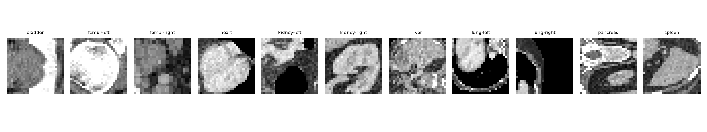
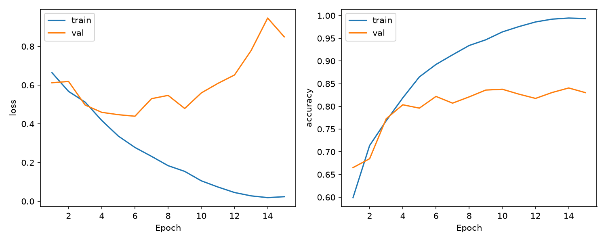
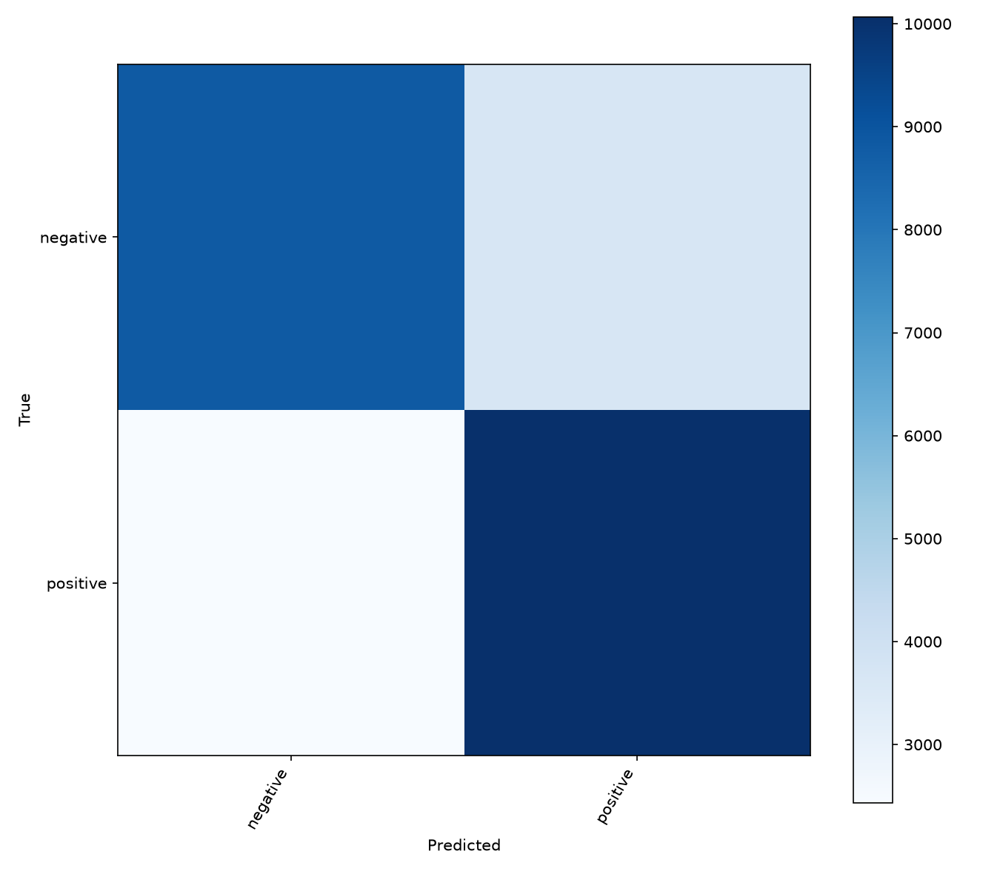
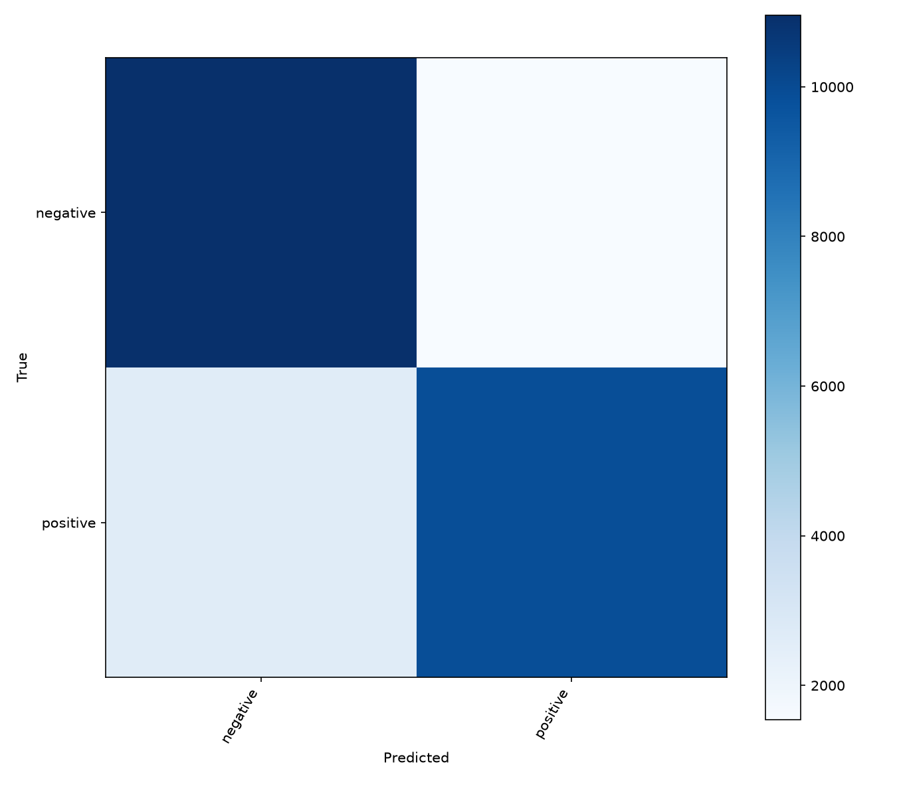
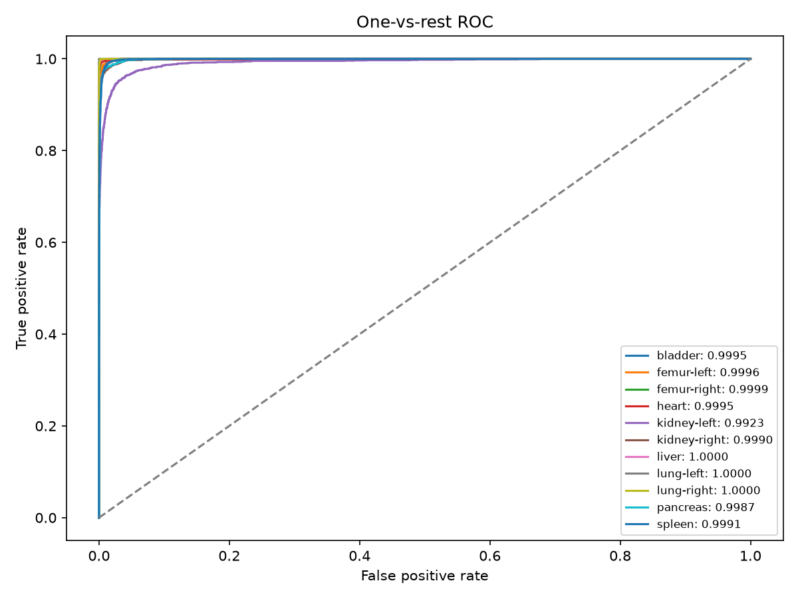
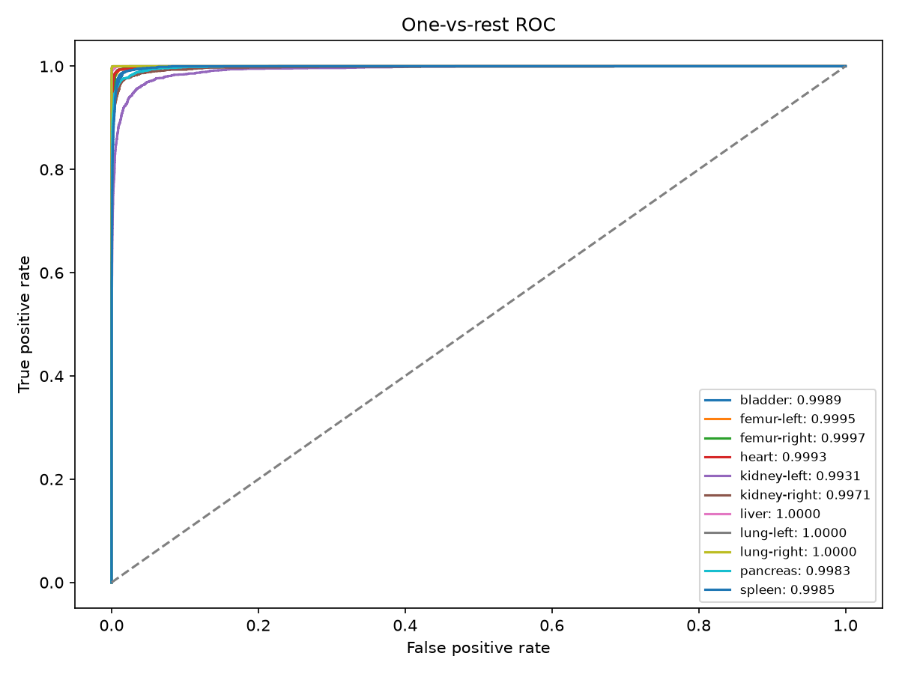
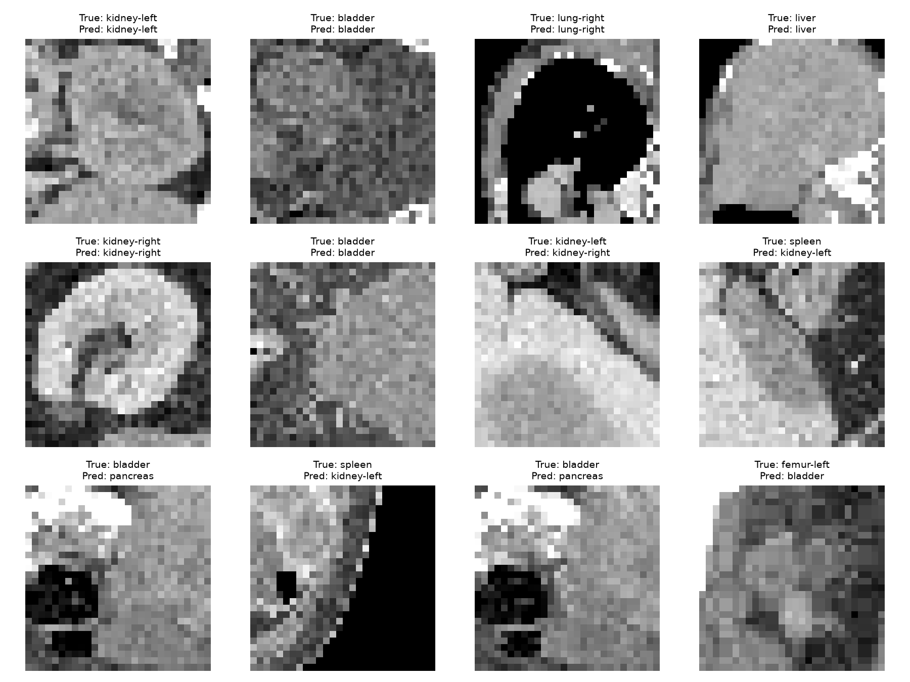
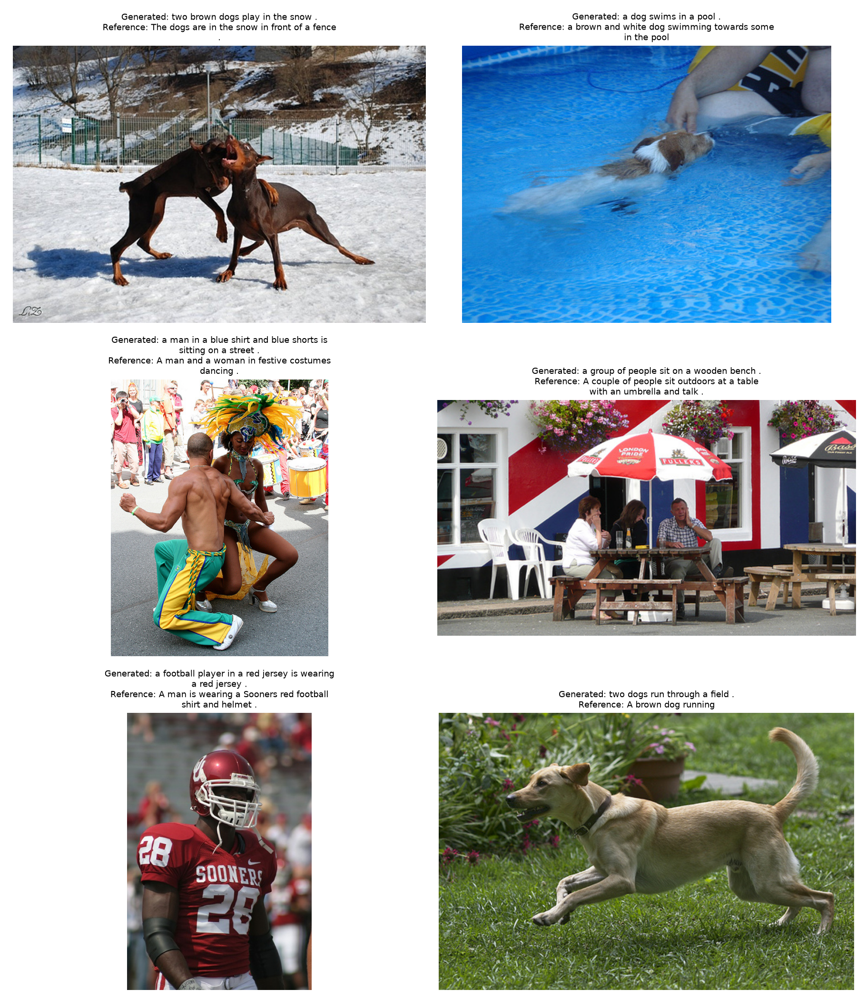
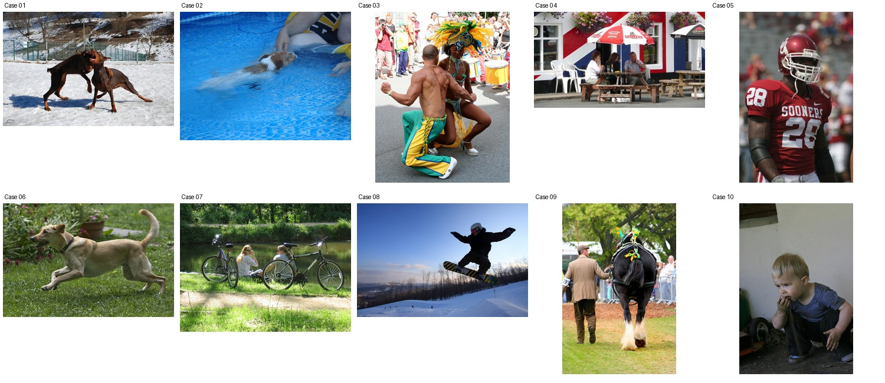

# Week 4 作業繳交報告

學生／操作人：JerryWu。本次完成 Quiz 1～4 基礎與進階項目；六模型有實際訓練、測試與輸出。

Gemini 項目採使用者指定的十張代表案例，兩模型共二十筆網頁手動評估。此處完成的是案例展示範圍，沒有宣稱原 100 張 API 研究已完成。

## Quiz 1：三種資料集準備

| dataset | train | val | test |
| --- | --- | --- | --- |
| imdb | 20000 | 5000 | 25000 |
| organamnist | 34561 | 6491 | 17778 |
| flickr8k | 6000 | 1000 | 1000 |

IMDb 為正／負情緒二分類，官方 train 分層切出 validation、官方 test 保持不變；文字去除 HTML、轉小寫、規則斷詞，字典只由 training 建立，最多前 256 tokens。OrganAMNIST 為十一類器官 CT，使用官方分割；28×28 灰階轉三通道並放大至 224×224。Flickr8k 使用官方影像層級分割，每張五段參考描述，同圖不跨集合，詞彙表只由 training captions 建立。

資料來源、類別、hash、處理與樣本見 [Quiz 1 報告](quiz1/Output/report.md)、[資料資訊](quiz1/Output/datasets.json)。

IMDb split ID 互斥，但來源含少量完全相同評論。排除測試集中與 train/validation 相同的 123 篇後，LSTM Accuracy 由 83.376% 降至約 83.318%，結論差異很小；仍保留原官方測試結果並揭露此限制。影像跨 split 沒有找到完全相同的像素／檔案，這不能排除近似資料；OrganAMNIST 無病患 ID 可供另行重建群組。

## Quiz 2：RNN 與 LSTM 情感分析

兩模型使用同一詞彙表、Embedding 128、hidden 256、dropout 0.3；最後一個有效 token 的狀態接分類層，避免 padding 影響。AdamW、learning rate 0.001、batch 128，交叉熵與梯度裁切，依 validation Accuracy 選最佳權重，使用完整 test 推論。

| model | Accuracy (%) | Macro-F1 | parameters | training_seconds | positive ROC-AUC |
| --- | --- | --- | --- | --- | --- |
| rnn | 75.616000 | 0.755564 | 3939330 | 8.540000 | 0.816201 |
| lstm | 83.376000 | 0.833450 | 4235778 | 31.590000 | 0.901322 |

LSTM Accuracy 較 RNN 高 7.76 個百分點，但最佳模型 train 99.46%、validation 84.06%，有明顯過擬合；錯誤預測平均信心約 93.61%，需留意過度自信。高 Accuracy 不代表機率已校準。原始指標、逐筆預測與正誤文字案例均保留。

詳見 [Quiz 2 報告](quiz2/Output/report.md)。

## Quiz 3：ViT 與 ResNet 微調

ViT-B/16 與 ResNet-50 使用 ImageNet-1K V1 預訓練權重，分類頭改為十一類；先訓練 head 再微調全模型，兩者共用相同資料分割與確定性前處理，不使用隨機擴增。AdamW、learning rate 3e-05、batch 128，AMP FP16、TF32，依 validation Accuracy 選權重。

| model | Accuracy (%) | Macro-F1 | parameters | training_seconds | Macro-AUC | Top-5 (%) |
| --- | --- | --- | --- | --- | --- | --- |
| vit_b_16 | 96.641900 | 0.965712 | 85807115 | 676.020000 | 0.998868 | 99.921300 |
| resnet50 | 95.798200 | 0.953833 | 23530571 | 198.270000 | 0.998569 | 99.921300 |

ViT Accuracy 高約 0.84 個百分點、少錯 150 張；ResNet 參數較少且整批測試較快。Macro-AUC 差約 0.00030，單一 seed 不能推論普遍或統計顯著優勢。ViT kidney-left recall 約 88.23%，主要混淆之一為 kidney-left → spleen，需搭配各類指標討論。

詳見 [Quiz 3 報告](quiz3/Output/report.md)。

## Quiz 4：影像描述、BLEU、時間與 Gemini

共用凍結的 ImageNet ResNet-50 空間特徵編碼器，分別從頭訓練 LSTM 與 Transformer decoder。training 使用 teacher forcing，忽略 PAD 的交叉熵，validation token loss 選模型；推論只輸入圖片特徵與 BOS，不提供參考句。兩模型均測試 greedy 與 beam search（beam width=3）。

| model | decoding | BLEU-4 x100 | decoder_mean_ms | estimated_pipeline_ms |
| --- | --- | --- | --- | --- |
| lstm | greedy | 17.370300 | 17.082000 | 25.090000 |
| lstm | beam | 20.924300 | 22.528000 | 30.536000 |
| transformer | greedy | 19.176000 | 26.944000 | 34.953000 |
| transformer | beam | 21.334500 | 37.131000 | 45.139000 |

BLEU 使用全部 1,000 張測試影像與每張五段參考句、無 smoothing；上表乘以 100 顯示，不能解讀為圖片描述正確率。Beam Search 提高分數也增加解碼時間。Transformer/beam 比 LSTM/beam 高約 0.41 BLEU 點，平均 decoder 延遲約 1.65 倍。

時間比較使用相同三十張圖片、batch=1、暖機、重複三次與 CUDA 同步。estimated_pipeline_ms 是分開量測的影像讀取／前處理／編碼平均時間加上解碼平均時間，不是逐張端到端計時。LSTM 訓練 30 epochs、Transformer 14 epochs，總時間不能直接當作等 epoch 效率比較。

### Gemini 手動審核

依主體、動作、場景、數量、幻覺與重複用詞等類型人工挑選十張測試圖。每圖兩段描述匿名為 A/B、位置平衡隨機；每批五張，兩批完整回覆已匯入，沒有漏評或重複。兩段獨立評分，可同時符合或不符合；沒有向 Gemini 提供模型名稱或人工參考句。

介面模型／模式：3.1 pro（依使用者記錄，非 API 回傳的後端版本）；日期：2026-10-13。分數 0～5，4～5 為 match、2～3 為 partial、0～1 為 mismatch。

| model | successful | expected | mean_score_0_to_5 | match_rate | partial_rate | mismatch_rate |
| --- | --- | --- | --- | --- | --- | --- |
| lstm | 10 | 10 | 2.800000 | 0.400000 | 0.300000 | 0.300000 |
| transformer | 10 | 10 | 3.000000 | 0.500000 | 0.200000 | 0.300000 |

| case | topic | LSTM score/verdict | Transformer score/verdict |
| --- | --- | --- | --- |
| 01 | 動物／雪地；主體與場景正確，動作是否精確仍需判斷 | 4/5 match | 4/5 match |
| 02 | 動物／游泳；兩模型描述接近，作為較準確的候選案例 | 5/5 match | 5/5 match |
| 03 | 人物／舞蹈與人群；動作、衣著與場景可能誤判 | 1/5 mismatch | 1/5 mismatch |
| 04 | 多人／戶外餐桌；遺漏人物，以及描述憑空多出狗 | 3/5 partial | 5/5 match |
| 05 | 運動員；主體正確但虛構被擒抱的動作，另一描述較籠統 | 2/5 partial | 5/5 match |
| 06 | 動物／草地；一隻狗被描述成兩隻，對照數量錯誤 | 5/5 match | 2/5 partial |
| 07 | 人物／自行車；坐在車旁被誤認為騎車，含場景誤判 | 0/5 mismatch | 0/5 mismatch |
| 08 | 人物／滑雪跳躍；兩模型能辨識主要動作的候選案例 | 5/5 match | 5/5 match |
| 09 | 人物／牽馬；騎乘與步行混淆，含主詞與語意不合理 | 1/5 mismatch | 1/5 mismatch |
| 10 | 兒童；床／椅子的場景幻覺、衣著誤判與重複用詞 | 2/5 partial | 2/5 partial |

這是刻意涵蓋成功與錯誤案例的展示，40%／50% 符合率只描述本批十張圖片，不能外推整體測試集。Gemini 判斷也可能有誤；原始回覆與理由保留供人工查核。

完整資料：[評估報告](quiz4/Output/gemini_cases10/report.md)、[第一批原始回覆](quiz4/Output/gemini_cases10/responses/batch_01.txt)、[第二批原始回覆](quiz4/Output/gemini_cases10/responses/batch_02.txt)、[A/B 對照](quiz4/Output/gemini_cases10/manifest.json)、[完整評分](quiz4/Output/gemini_cases10/judgments.json)。

## 執行與繳交檔案

Python 3.12、PyTorch 2.9.1+cu128、torchvision 0.24.1+cu128；RTX 5090 約 32 GiB 顯存、Core Ultra 7 265K、32 GB RAM。設定、環境 YAML、執行腳本與四份 Notebook 隨包提供。

主要繳交包包含原始碼、資料來源與分割資訊、圖表、完整預測、評估指標、訓練曲線及 Gemini 原始回覆。六個最佳模型 best.pt 另放模型權重包，解壓後與主包相同 week4_homework/ 路徑合併。原始大型資料集、caption 特徵快取、last.pt optimizer 續訓狀態與重複 head warmup 權重未打包。重新執行須先依 README 的 prepare 階段下載並重建資料，不能把這份精簡資料包視為完整離線訓練資料。

要求對照見 [RUBRIC.md](RUBRIC.md)，核對與限制詳見 [結果審查](analysis/results_review.md)。
