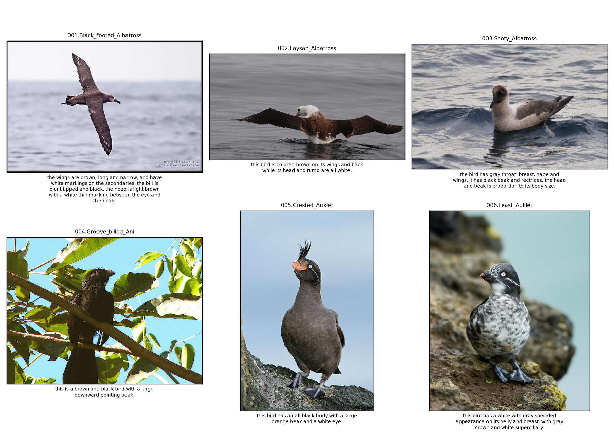
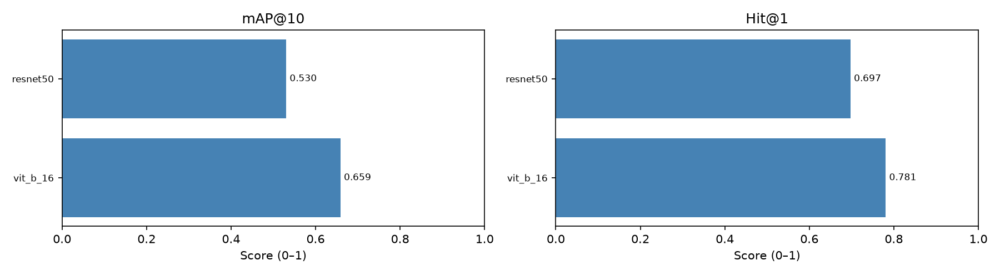

# Quiz 1：CNN / ViT 鳥類影像檢索

## 資料與切分

CUB-200-2011 影像與鳥種類別；Reed 原始人工描述另供 Quiz2 使用。官方 image-level test 保持不變，官方 train 分層切出 validation。驗證與測試各自按鳥種拆 query/gallery，兩者不含同一 image ID；以同鳥種定義相關結果，這是類別語意檢索，不是同一隻鳥的個體識別。

| split | images |
| --- | --- |
| train | 4795 |
| val | 1199 |
| test | 5794 |

資料檢查見 data_audit.json；訓練集有一組同類別重複 JPEG，沒有跨 train/val/test 或 query/gallery 的完全相同影像。

## 方法

ResNet-50 / ViT-B/16 使用 ImageNet-1K V1 預訓練，整個影像編碼器與 256 維投影層實際訓練。P 個鳥種、每類 K 張不同圖片的 batch，loss = supervised contrastive loss + 0.5 × CE；L2-normalized embedding 以 cosine similarity 排序。train 隨機裁切與翻轉，val/test 確定性 resize/center crop。依 validation mAP@10 選模型，test 不用於選權重。history 的 train_accuracy 是輔助分類 Top-1，val_accuracy 欄位對應選模用的 mAP@10，兩者意義不同。

## 全部測試 query 結果

| backbone | map | map_at_10 | hit_at_1 | recall_at_10 | training_seconds | parameters |
| --- | --- | --- | --- | --- | --- | --- |
| resnet50 | 0.574533 | 0.530376 | 0.697359 | 0.412432 | 124.332253 | 24739848 |
| vit_b_16 | 0.692884 | 0.658867 | 0.780751 | 0.486416 | 166.464051 | 86375112 |

## 結果分析

本次 vit_b_16 的 mAP@10 較高（0.6589），與另一組相差 12.85 個百分點。這是同鳥種圖片的排序品質，不能解讀為鳥種分類準確率。

完整欄位保留於 comparison.csv / comparison.json。

hit_at_K：前 K 張至少有一張相關圖片的 query 比率；recall_at_K：前 K 張找回的相關圖片數／gallery 全部相關圖片數，再對 query 平均。precision_at_K 為前 K 張相關比例；AP@K 分母 min(K, gallery 相關圖片數)，mAP 是各 query AP 的平均。map 欄位評估完整排序。所有 query 都納入指標，示意圖挑選較強與較弱案例，綠色為同類、紅色為不同類。

每模型附 best.pt、history.csv、learning_curves.png、metrics.json、embeddings.npz、retrieval_results.csv、retrieval_examples.png。

## 限制

CUB 官方提醒資料可能與 ImageNet/Flickr 預訓練資料重疊，因此不宣稱對預訓練影像完全獨立的泛化結果。兩種 Backbone 共用相同資料、設定與評估條件，單次 seed 不宣稱統計顯著優勢。

來源：https://www.vision.caltech.edu/datasets/cub_200_2011/；https://github.com/taoxugit/AttnGAN。
