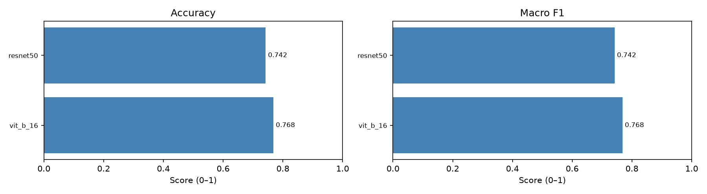

# Quiz 2：鳥類影像與文字的多模態分類

## 資料

共用 Quiz1 的 CUB 圖片 ID 與 200 類標籤、每張十句 Reed 人工描述。以圖片為切分單位，同圖的描述全部留在同一 split；不輸入標籤或含類別名稱的檔案路徑。訓練每個 epoch 每張圖選一句描述；validation/test 固定使用第一句，每張圖只評估一次。原文依檔名配對，不以生成描述或類別名稱冒充人工描述。

## 兩種組合

ResNet-50 + DistilBERT、ViT-B/16 + 相同 DistilBERT。文字模型凍結、attention-masked mean pooling，快取所有訓練描述。兩模態各投影至 256 維，串接後經 MLP 做分類；影像 Backbone、兩個投影層及融合分類頭實際訓練，驗證 Accuracy 選權重。

## 測試比較

| image_backbone | accuracy | macro_f1 | weighted_f1 | training_seconds | trainable_parameters |
| --- | --- | --- | --- | --- | --- |
| resnet50 | 0.742147 | 0.741714 | 0.740519 | 131.376175 | 24413192 |
| vit_b_16 | 0.768208 | 0.768052 | 0.767223 | 170.821933 | 86376136 |

## 結果分析

本次 vit_b_16 + DistilBERT 的測試 Accuracy 為 0.7682，較另一組高 2.61 個百分點；其 Macro-F1 為 0.7681。Macro-F1 讓每個鳥種等權重，可與 Accuracy 一起檢查少數類別的表現。 resnet50 最佳 epoch 17 的 train / val Accuracy 為 0.9798 / 0.7264；vit_b_16 最佳 epoch 19 的 train / val Accuracy 為 0.9914 / 0.7715。 訓練與驗證的差距需配合 learning_curves.png 判讀過擬合；訓練影像含隨機擴增、文字也會輪換，兩者測量條件不同。

完整欄位保留於 comparison.csv / comparison.json。

兩組保留相同文字 Backbone、資料與融合結構，主要比較影像 Backbone。training_seconds 為 epoch 訓練／驗證迴圈，文字特徵抽取時間另存；test_seconds 使用預先快取文字特徵，不代表從原始文字開始的端到端推論延遲。

每模型附 best.pt、history.csv、learning_curves.png、metrics.json、classification_report.json、confusion_matrix.png/npy、confusions.csv、predictions.csv、probabilities.npz、prediction_examples.png。完整矩陣以類別索引顯示，classes.json 可還原類名。

同樣保留 CUB 預訓練重疊限制；不以融合模型分數直接主張文字或圖片各自的因果貢獻。
