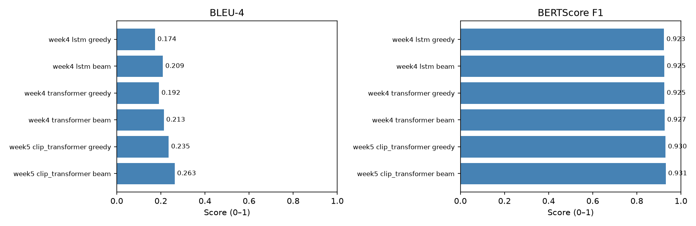

# Quiz 3：CLIP Image Captioning 與 Week4 比較

## 資料與模型

直接讀取 Week4 Flickr8k 的 6000/1000/1000 image-level split、原始圖片、五段參考句及 training-only 詞彙表；不改動 Week4 資料、權重、預測或報告。CLIP ViT-B/32 影像編碼器凍結，移除 CLS、逐 patch post-LayerNorm，再平均池化成 4×4 空間特徵。可訓練投影層把 768 維 CLIP 特徵接上與 Week4 相同主要設定的 Transformer Decoder。teacher forcing、PAD 忽略交叉熵，validation token loss 選模型。測試從 BOS 開始生成，不提供參考句；同時跑 greedy/beam。

影像 SHA256 檢查沒有跨 split 的完全相同圖片；訓練集中有兩個檔名對應相同 JPEG，保留 Week4 原始切分以維持比較條件，詳見 data_audit.json。

投影輸入由 ResNet 的 2048 維改成 CLIP 的 768 維，這部分參數量不同，並非聲稱所有參數與預訓練資料都完全一致。

## 本週 BLEU 與時間

| decoding | bleu1 | bleu2 | bleu3 | bleu4 | decoder_mean_ms | estimated_pipeline_mean_ms | training_seconds |
| --- | --- | --- | --- | --- | --- | --- | --- |
| greedy | 0.683429 | 0.486743 | 0.341411 | 0.235462 | 26.076707 | 34.070738 | 46.777423 |
| beam | 0.703337 | 0.510691 | 0.367770 | 0.262774 | 31.772633 | 39.766664 | 46.777423 |

## Week4 / Week5 統一重算比較

| week | model | decoding | bleu4 | bertscore_f1 | decoder_mean_ms | estimated_pipeline_mean_ms | empty_captions |
| --- | --- | --- | --- | --- | --- | --- | --- |
| week4 | lstm | greedy | 0.173703 | 0.923467 | 17.081699 | 25.090062 | 0 |
| week4 | lstm | beam | 0.209243 | 0.925216 | 22.527867 | 30.536230 | 0 |
| week4 | transformer | greedy | 0.191760 | 0.924846 | 26.944431 | 34.952794 | 0 |
| week4 | transformer | beam | 0.213345 | 0.926703 | 37.130943 | 45.139307 | 0 |
| week5 | clip_transformer | greedy | 0.235462 | 0.930266 | 26.076707 | 34.070738 | 0 |
| week5 | clip_transformer | beam | 0.262774 | 0.931175 | 31.772633 | 39.766664 | 0 |

## 結果分析

六組中 BLEU-4 最高為 week5 clip_transformer beam（0.2628）；BERTScore F1 最高為 week5 clip_transformer beam（0.9312）。 CLIP greedy 相對 Week4 Transformer 的 BLEU-4 差值為 +0.0437，BERTScore F1 差值為 +0.0054。 CLIP beam 相對 Week4 Transformer 的 BLEU-4 差值為 +0.0494，BERTScore F1 差值為 +0.0045。 指標升降是本次固定測試集上的觀察，較高的語意相似度仍可能伴隨物體或動作描述錯誤。

完整欄位保留於 comparison.csv / comparison.json。

比較六組：Week4 ResNet+LSTM / ResNet+Transformer，各 greedy/beam；Week5 CLIP+Transformer，greedy/beam。先核對每組完整 1000 張 ID 與五參考句，再用同一實作重算 BLEU-1～4。BERTScore 共用 RoBERTa-base 第 10 層、無 IDF、不 rescale；五參考句模式依官方函式分別取 P/R/F1 最大值，若模型生成空描述，保留該圖片並記錄 empty_captions，不從測試集刪除。保存 scorer hash、設定及逐圖分數。兩種指標不是描述正確率，預訓練評估模型也有其偏好。

延遲測量共用固定前三十張測試圖、batch=1、三次重複、暖機與 CUDA 同步；估計 pipeline 時間為分開量測的 encoder 與 decoder 均值之和。特徵抽取、訓練與 BERTScore 耗時分開。不同模型可能提早停止，總訓練時間不等於相同 epoch 的效率比較。

來源：https://huggingface.co/openai/clip-vit-base-patch32；https://github.com/Tiiiger/bert_score。
