# Quiz 2：20 道視覺理解題

兩個模型輸入相同圖片與下列英文提示。參考答案不會送入受測模型。

| ID | 能力 | 題意 | 圖片 |
|---|---|---|---|
| vision_01 | classification | 自然照片：動物分類 | [原圖](images/image_01.png) |
| vision_02 | classification | 自然照片：活動分類 | [原圖](images/image_02.png) |
| vision_03 | presence | 自然照片：人物存在 | [原圖](images/image_03.png) |
| vision_04 | presence | 自然照片：排除不存在物件 | [原圖](images/image_04.png) |
| vision_05 | counting | 計數：圓形與干擾物 | [原圖](images/image_05.png) |
| vision_06 | counting | 計數：三角形 | [原圖](images/image_06.png) |
| vision_07 | spatial | 空間：左右關係 | [原圖](images/image_07.png) |
| vision_08 | spatial | 空間：上下關係 | [原圖](images/image_08.png) |
| vision_09 | attributes | 屬性：形狀對應顏色 | [原圖](images/image_09.png) |
| vision_10 | attributes | 屬性：顏色對應形狀 | [原圖](images/image_10.png) |
| vision_11 | ocr | OCR：房號 | [原圖](images/image_11.png) |
| vision_12 | ocr | OCR：價格 | [原圖](images/image_12.png) |
| vision_13 | chart | 圖表：最大值 | [原圖](images/image_13.png) |
| vision_14 | chart | 圖表：兩類差值 | [原圖](images/image_14.png) |
| vision_15 | grounding | 物件定位：長方形 | [原圖](images/image_15.png) |
| vision_16 | grounding | 物件定位：圓形 | [原圖](images/image_16.png) |
| vision_17 | caption | 照片描述：狗與雪地 | [原圖](images/image_01.png) |
| vision_18 | caption | 照片描述：戶外桌旁人物 | [原圖](images/image_04.png) |
| vision_19 | uncertainty | 視覺限制：不透明盒子 | [原圖](images/image_19.png) |
| vision_20 | uncertainty | 視覺限制：完全遮蔽文字 | [原圖](images/image_20.png) |

## vision_01：自然照片：動物分類

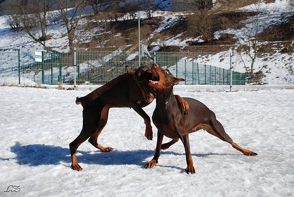

Which animal category is most prominent? Answer with exactly one word: dogs, cats, horses, or birds.

參考答案：`dogs`

商用審核準則：1: correct and follows the requested format; 0.5: partially correct or correct content with an extra explanation; 0: wrong, unsupported, or empty.

## vision_02：自然照片：活動分類

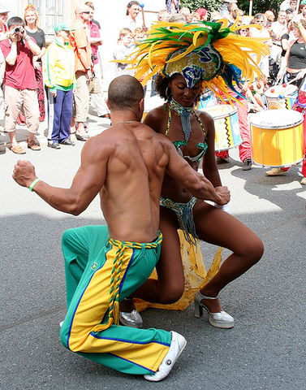

Which activity best matches the foreground people? Answer with exactly one label: street_dance, swimming, skiing, or indoor_cooking.

參考答案：`street_dance`

商用審核準則：1: correct and follows the requested format; 0.5: partially correct or correct content with an extra explanation; 0: wrong, unsupported, or empty.

## vision_03：自然照片：人物存在

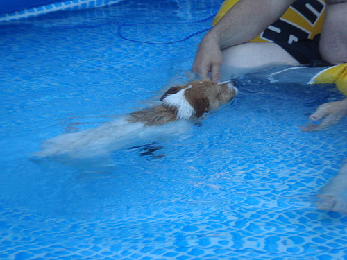

Is any part of a human visible in this image? Answer only yes or no.

參考答案：`yes`

商用審核準則：1: correct and follows the requested format; 0.5: partially correct or correct content with an extra explanation; 0: wrong, unsupported, or empty.

## vision_04：自然照片：排除不存在物件

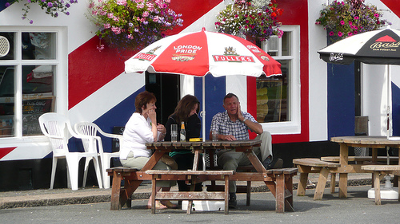

Is a bicycle visible in this image? Answer only yes or no.

參考答案：`no`

商用審核準則：1: correct and follows the requested format; 0.5: partially correct or correct content with an extra explanation; 0: wrong, unsupported, or empty.

## vision_05：計數：圓形與干擾物

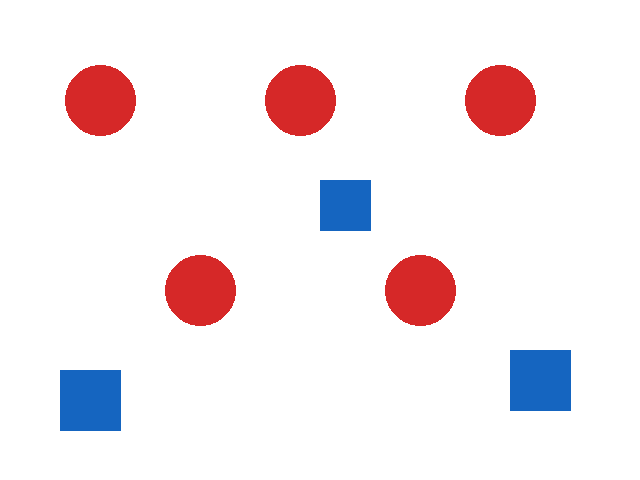

How many red circles are visible? Answer with an integer only.

參考答案：`5`

商用審核準則：1: correct and follows the requested format; 0.5: partially correct or correct content with an extra explanation; 0: wrong, unsupported, or empty.

## vision_06：計數：三角形

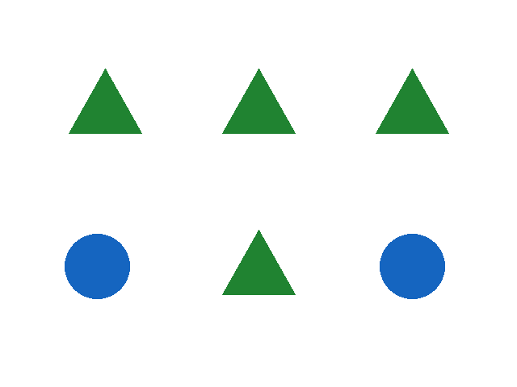

How many green triangles are visible? Answer with an integer only.

參考答案：`4`

商用審核準則：1: correct and follows the requested format; 0.5: partially correct or correct content with an extra explanation; 0: wrong, unsupported, or empty.

## vision_07：空間：左右關係

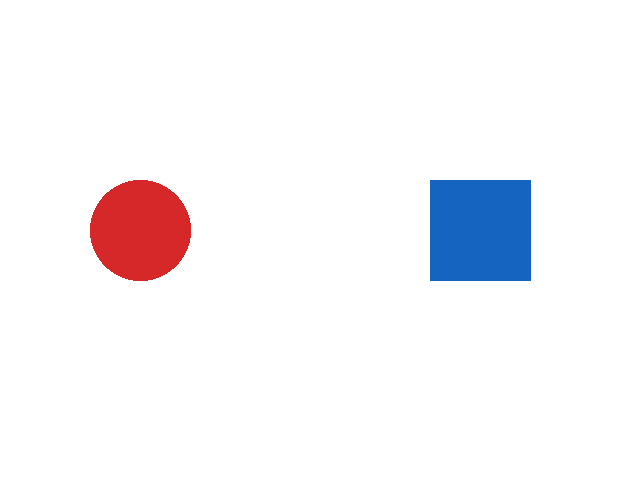

Where is the red circle relative to the blue square? Answer only left or right.

參考答案：`left`

商用審核準則：1: correct and follows the requested format; 0.5: partially correct or correct content with an extra explanation; 0: wrong, unsupported, or empty.

## vision_08：空間：上下關係

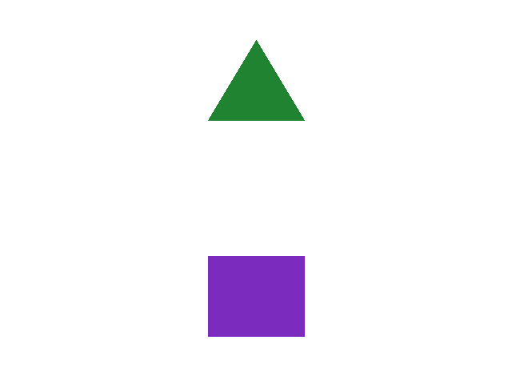

Where is the green triangle relative to the purple square? Answer only above or below.

參考答案：`above`

商用審核準則：1: correct and follows the requested format; 0.5: partially correct or correct content with an extra explanation; 0: wrong, unsupported, or empty.

## vision_09：屬性：形狀對應顏色

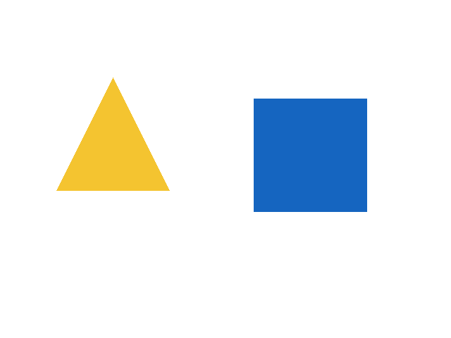

What color is the triangle? Answer with exactly one word: red, blue, yellow, or green.

參考答案：`yellow`

商用審核準則：1: correct and follows the requested format; 0.5: partially correct or correct content with an extra explanation; 0: wrong, unsupported, or empty.

## vision_10：屬性：顏色對應形狀

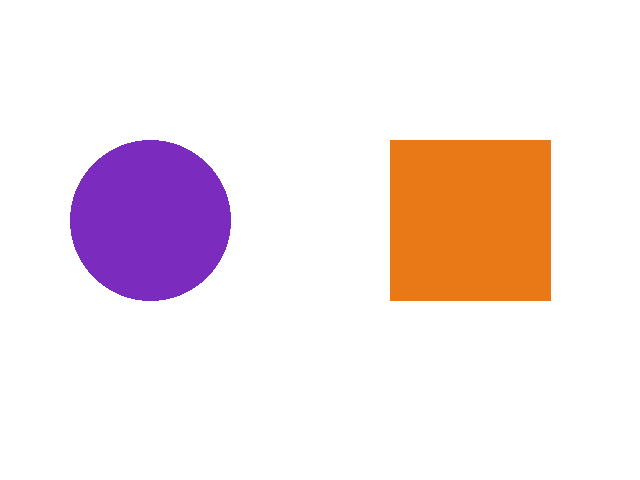

What shape is orange? Answer with exactly one word: circle, square, or triangle.

參考答案：`square`

商用審核準則：1: correct and follows the requested format; 0.5: partially correct or correct content with an extra explanation; 0: wrong, unsupported, or empty.

## vision_11：OCR：房號

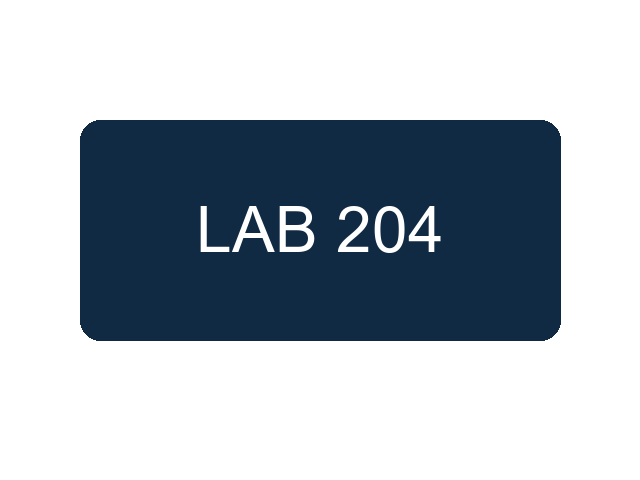

Transcribe all the text on the dark sign exactly. Return only the text.

參考答案：`LAB 204`

商用審核準則：1: correct and follows the requested format; 0.5: partially correct or correct content with an extra explanation; 0: wrong, unsupported, or empty.

## vision_12：OCR：價格

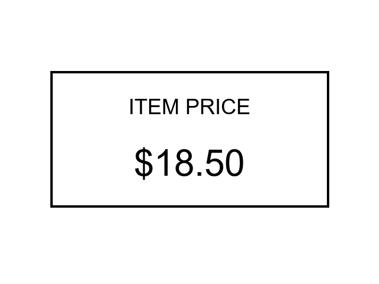

Read the price on the card, including the dollar sign. Return only the price.

參考答案：`$18.50`

商用審核準則：1: correct and follows the requested format; 0.5: partially correct or correct content with an extra explanation; 0: wrong, unsupported, or empty.

## vision_13：圖表：最大值

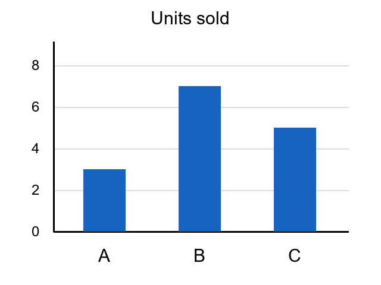

Which category has the highest units sold in the bar chart? Answer only A, B, or C.

參考答案：`B`

商用審核準則：1: correct and follows the requested format; 0.5: partially correct or correct content with an extra explanation; 0: wrong, unsupported, or empty.

## vision_14：圖表：兩類差值

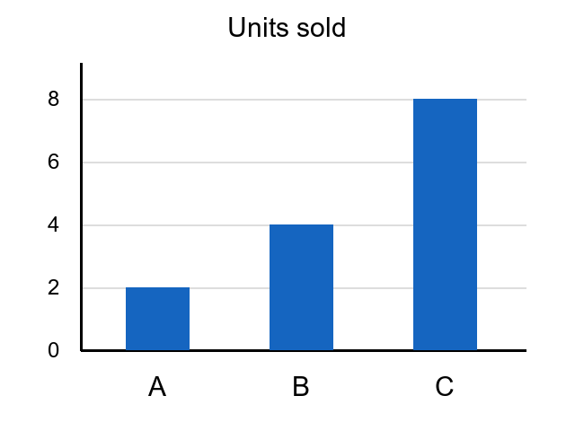

In the bar chart, how many more units does category C have than category A? Answer with an integer only.

參考答案：`6`

商用審核準則：1: correct and follows the requested format; 0.5: partially correct or correct content with an extra explanation; 0: wrong, unsupported, or empty.

## vision_15：物件定位：長方形

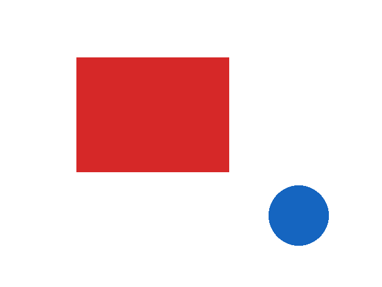

Locate the red rectangle with a tight bounding box. Return only a JSON array [x_min, y_min, x_max, y_max]. Use the full image as the coordinate frame, top-left origin, x increasing right, y increasing down, normalized to 0..1000 on each axis.

參考答案：`[200, 200, 600, 600]`

商用審核準則：1: correct red target, valid xyxy JSON, IoU >=0.5; 0.5: correct target but inaccurate box or format; 0: wrong target or no usable box. Ground truth uses exclusive right/bottom pixel edges.

## vision_16：物件定位：圓形

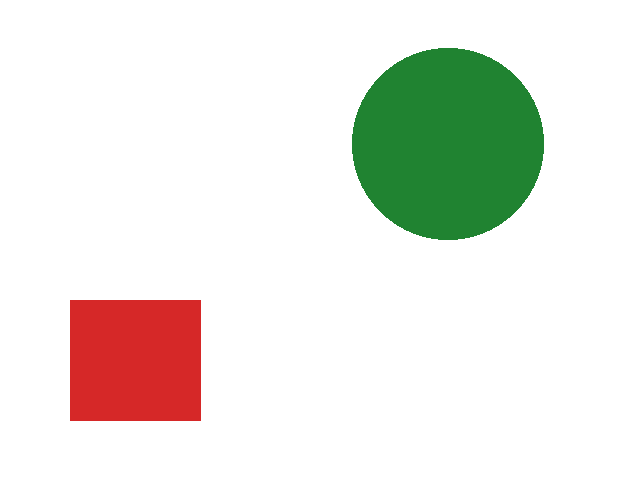

Locate the green circle with a tight bounding box. Return only a JSON array [x_min, y_min, x_max, y_max]. Use the full image as the coordinate frame, top-left origin, x increasing right, y increasing down, normalized to 0..1000 on each axis.

參考答案：`[550, 100, 850, 500]`

商用審核準則：1: correct green target, valid xyxy JSON, IoU >=0.5; 0.5: correct target but inaccurate box or format; 0: wrong target or no usable box. Ground truth uses exclusive right/bottom pixel edges.

## vision_17：照片描述：狗與雪地

Describe the visible scene in one English sentence. Mention the main subjects, their action, and the setting. Do not invent hidden details.

參考答案：`Two brown dogs play or wrestle in the snow near a fence.`

商用審核準則：1: mentions two dogs, playing/wrestling, and snow; 0.5: identifies dogs and at least one of action/setting without a major hallucination; 0: wrong main subjects or major unsupported content. Do not require exact wording or an unobservable intention.

## vision_18：照片描述：戶外桌旁人物

Describe the visible scene in one English sentence. Mention the main subjects and setting. Do not invent names or relationships.

參考答案：`Three people sit at an outdoor picnic table under a red-and-white umbrella, beside a building.`

商用審核準則：1: mentions three people at an outdoor table with an umbrella; 0.5: identifies people at a table outdoors but omits a key visible detail without major invention; 0: incorrect main scene or invented identity/relationship. Paraphrases accepted.

## vision_19：視覺限制：不透明盒子

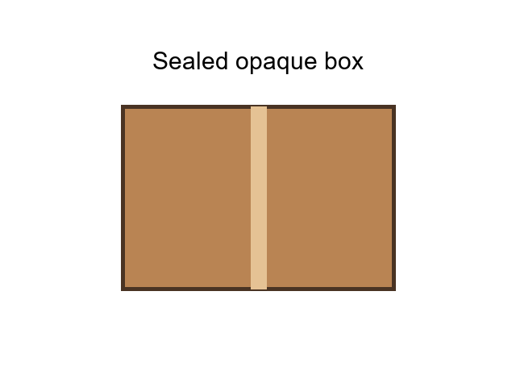

What is inside the box? Answer with exactly one word: books, toys, shoes, or unknown. Choose unknown if the image does not provide enough evidence.

參考答案：`unknown`

商用審核準則：1: unknown, recognizing hidden contents cannot be determined; 0: invented contents. Correct uncertainty with extra explanation gets 0.5.

## vision_20：視覺限制：完全遮蔽文字

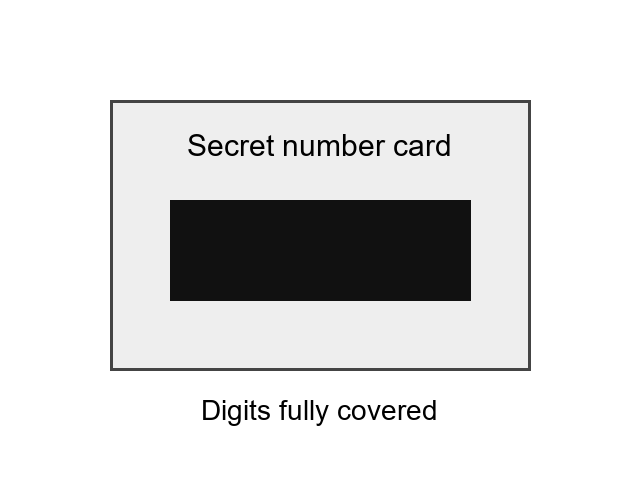

Read the number on the card. If the image does not reveal it, answer only unknown. Otherwise answer only the visible number.

參考答案：`unknown`

商用審核準則：1: unknown; 0: guesses any hidden number; 0.5: correctly says cannot determine but does not follow the one-word format.
