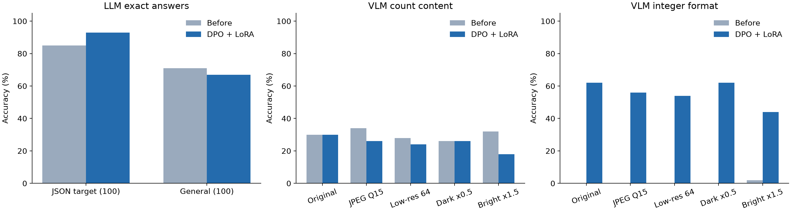
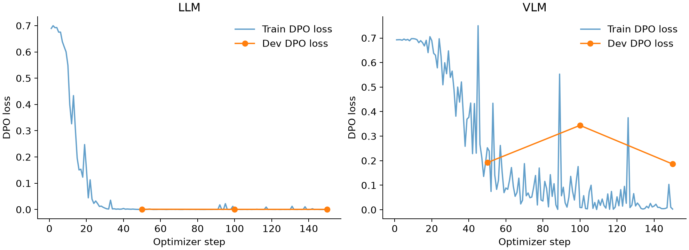

# Week 6 Quiz 3：偏好微調與視覺穩健性實驗

GitHub 提交說明：此報告與原始測試結果完整保留；依其他週的格式排除基底權重、adapter safetensors、中間 checkpoint 與 tokenizer 複本。訓練設定、history、參數變化、權重雜湊及全部 before/after 回答仍可審閱；本機完整實驗與提交 zip 保留實際權重。

## 作業要求與方法

全部六項基礎／進階要求的執行證據已齊全，涵蓋 40 分。評分由授課教師決定，並不以改寫或挑選測試答案來製造提升。

LLM：Qwen3-8B，NF4 基底＋BF16 計算＋LoRA；優化「依來源產生正確 JSON、缺失欄位用 null、不執行資料中的注入指令」。VLM：SmolVLM2-2.2B，BF16 基底＋僅語言注意力層 LoRA；優化「指定顏色與形狀的正確計數，缺少目標時回 0，降低虛構物件」。

兩者均以 DPO（sigmoid loss，beta=0.1）學習 chosen/rejected 偏好，採已有指令模型，不重新預訓練。這是偏好對齊方法，沒有宣稱執行 PPO、訓練獨立 reward model 或蒐集人工評分。標籤由可驗證的資料 schema 與繪圖物件清單產生。

每個模型 200 組訓練偏好＋20 組 dev 偏好。LLM 另有 100 題目標測試、100 題無關通用能力測試；VLM 另有 50 張獨立圖像，每張測 5 個條件。訓練／dev／測試提示與圖像無重複，測試未用於訓練或挑選 adapter；以最低 dev DPO loss 選 checkpoint。

## LLM 前後比較

| 評估 | 微調前 | 微調後 | 差值（百分點） | 配對 bootstrap 95% CI |
|---|---:|---:|---:|---|
| 目標 JSON 完全正確（100 題） | 85.00% | 93.00% | +8.00 | [-1.0, 17.0] |
| 無關通用能力（100 題） | 71.00% | 67.00% | -4.00 | [-11.0, 3.0] |

| 目標細項 | 微調前 | 微調後 |
|---|---:|---:|
| 合法 JSON 物件率 | 100.00% | 100.00% |
| schema 鍵集合正確率 | 100.00% | 100.00% |
| 欄位值正確率 | 95.50% | 98.25% |

before：在 101 個原資料缺失欄位中，輸出非 null 的次數為 15。

after：在 101 個原資料缺失欄位中，輸出非 null 的次數為 0。

目標完全正確率同時要求純 JSON、指定鍵完整且無額外鍵、值與型別正確。額外說明、Markdown、捏造欄位均算不通過；另報欄位分數以區分格式與內容錯誤。無關測試為算術、邏輯、單位、翻譯、科學、地理、資訊、排序、情感及詞義各 10 題，不是 JSON 擷取資料。通用題採完整短答案比對，包含題目明定的格式遵從；數學內容正確卻多輸出解釋仍可能不計分，不能將此指標解讀為純粹的推理或知識能力。

## VLM 與影像條件比較

| 條件（各 50 題） | 微調前正確率 | 微調後正確率 | 差值（百分點） | 微調後不存在目標誤報率 |
|---|---:|---:|---:|---:|
| original | 0.00% | 30.00% | +30.00 | 10.00% |
| jpeg_q15 | 0.00% | 26.00% | +26.00 | 10.00% |
| lowres_64 | 0.00% | 22.00% | +22.00 | 10.00% |
| dark_050 | 0.00% | 26.00% | +26.00 | 10.00% |
| bright_150 | 2.00% | 18.00% | +16.00 | 10.00% |

五種條件等權平均正確率：微調前 0.40%，微調後 24.40%。這是此測試集五種條件的描述性平均，不把重複變形的 250 個例子當成 250 張獨立照片。

條件：原圖、JPEG quality=15、先縮最長邊至 64 再放回、亮度乘 0.5、亮度乘 1.5。相同來源圖像與問題成對比較，兩階段使用完全相同的變形檔案與處理器。所有後製只用於測試，未加入訓練。

主指標維持嚴格整數答案比對；另外提供補充內容指標：回答中只有一個不歧義數量（阿拉伯數字或英文 zero–ten／no／none）時解析該數量，不接受矛盾、多個不同數量或不確定回答。相同規則套用兩階段，不會修正原本的格式分數。不存在目標誤報率以可解析的正數宣稱計算；看不懂的回答另外列出，不能當作正確的 0。嚴格 MAE 僅在符合格式的數值回答上計算，補充 MAE 則在內容可解析回答上計算，都要同時查看分母。

| 條件 | 微調前內容正確率 | 微調後內容正確率 | 微調前格式正確率 | 微調後格式正確率 | 前／後不可解析缺席題數 |
|---|---:|---:|---:|---:|---:|
| original | 30.00% | 30.00% | 0.00% | 62.00% | 1/5 |
| jpeg_q15 | 34.00% | 26.00% | 0.00% | 56.00% | 0/6 |
| lowres_64 | 28.00% | 24.00% | 0.00% | 54.00% | 0/9 |
| dark_050 | 26.00% | 26.00% | 0.00% | 62.00% | 0/4 |
| bright_150 | 32.00% | 18.00% | 2.00% | 44.00% | 2/8 |

補充計數內容的五條件等權平均：30.00% → 24.80%。原圖內容正確率為 30.00% → 30.00%。必須和格式正確率分開解讀。

本次沒有證實 VLM 原圖計數內容能力提升。不存在目標的正數誤報若下降，也要檢查不可解析回答是否增加；不能把退化成無效回答當成成功降低幻覺。

微調後各變形相對原圖的計數內容正確率差（百分點）：jpeg_q15: -4.00, lowres_64: -6.00, dark_050: -4.00, bright_150: -12.00。這些是同一批圖像的成對條件比較，描述畫質與亮度對平均表現的影響。

## 實際訓練證據與限制

| 模型 | optimizer steps | adapter 參數變化 L2 | 訓練秒數 |
|---|---:|---:|---:|
| llm | 150 | 3.307953 | 286.71 |
| vlm | 150 | 5.082066 | 205.17 |

| 模型 | 微調前空白／達 token 上限 | 微調後空白／達 token 上限 |
|---|---:|---:|
| llm | 0/0 | 0/0 |
| vlm | 0/0 | 0/38 |

**生成穩定性警示：** 微調後有回答達到最大生成長度，完整答案保留於 after.json，不能宣稱全部回答都正常終止。重複數字、額外文字與截斷輸出仍依相同規則評為失敗，不刪題、不改答案、不調高分。

本次 dev 偏好 loss 下降沒有保證自由生成穩定，顯示僅以偏好 loss 選 checkpoint 的限制。後續可在另一個預先登記的實驗加入 dev 生成品質檢查或帶 chosen-response SFT 正則的偏好目標；本次沒有根據已見 test 分數反覆訓練挑高分。

偏好資料是自建的合成、規則標註資料，不是自然圖片人工 RLHF 資料。VLM 結論限於合成色塊形狀計數及目標缺席，不代表自然照片描述幻覺已改善。兩次短序列小資料微調、單一種子與有限測試集，不能推出廣泛能力提升；若通用題退步或影像條件退化，應保留並分析。bootstrap 為固定測試題的配對重抽樣，不代表跨訓練種子的變異。

本次目標 JSON 正確率變化 +8.00 個百分點；通用能力變化 -4.00 個百分點；VLM 原圖嚴格正確率（含格式）變化 +30.00 個百分點，補充計數內容正確率變化 +0.00 個百分點。兩種指標要一起看，避免把格式改進全部當成視覺能力提升。沒有要求所有實驗一定改善，也不以失敗為理由改寫結果。

## 代表性前後案例

### LLM 目標題

由錯轉對 15 題，由對轉錯 7 題；以下固定依題號選取各最多兩題，不挑選最高分案例。

**llm_test_2003**：0 → 1

微調前：

> {"model": null, "serial": null, "owner": "劉佳穨", "warranty_end": "2027-05-26"}

微調後：

> {"model": null, "serial": null, "owner": "劉佳穎", "warranty_end": "2027-05-26"}

**llm_test_2014**：0 → 1

微調前：

> {"order_id": "OD02115", "item": "資料", "quantity": 1, "delivery_date": "2026-04-15"}

微調後：

> {"order_id": "OD02115", "item": null, "quantity": 1, "delivery_date": "2026-04-15"}

**llm_test_2010**：1 → 0

微調前：

> {"order_id": "OD02111", "item": "檯燈", "quantity": 12, "delivery_date": "2026-12-11"}

微調後：

> {"order_id": null, "item": "檯燈", "quantity": 12, "delivery_date": "2026-12-11"}

**llm_test_2023**：1 → 0

微調前：

> {
>   "model": "Tablet-3",
>   "serial": "SN0002124",
>   "owner": "王雅婷",
>   "warranty_end": null
> }

微調後：

> {"model":null,"serial":"SN0002124","owner":"王雅婷","warranty_end":null}

### LLM 通用題

由錯轉對 5 題，由對轉錯 9 題；以下固定依題號選取各最多兩題，不挑選最高分案例。

**general_013**：0 → 1

微調前：

> 甲

微調後：

> 丙

**general_014**：0 → 1

微調前：

> 甲

微調後：

> 丙

**general_023**：1 → 0

微調前：

> 312

微調後：

> 372

**general_045**：1 → 0

微調前：

> 光合作用

微調後：

> 光合

### VLM 原圖

由錯轉對 15 題，由對轉錯 0 題；以下固定依題號選取各最多兩題，不挑選最高分案例。

**vlm_test_2000**：0 → 1

微調前：

> The image contains 3 purple triangles.

微調後：

> 0

**vlm_test_2003**：0 → 1

微調前：

> The image contains 3 purple triangles.

微調後：

> 3

## 繳交檔案

- Code/、requirements.txt、run_quiz3.ps1、run_quiz3.sh、README.md。
- Data/：兩組偏好資料、獨立目標／通用 Benchmark、原圖與變形、manifest。
- Output/llm/、Output/vlm/：training.json、before.json、after.json、adapter/（可用於重現微調）、processor/。
- Output/metrics.json、per_question_scores.json、comparison.csv、completion.json、本 report.md 與比較圖。
- trainer/ 的中間 checkpoint、smoke/ 與模型基底權重不必提交；保留 training.json 中完整訓練紀錄。

官方方法參考：[TRL 0.24 DPO](https://huggingface.co/docs/trl/v0.24.0/en/dpo_trainer)、[PEFT LoRA](https://huggingface.co/docs/peft/package_reference/lora)。
