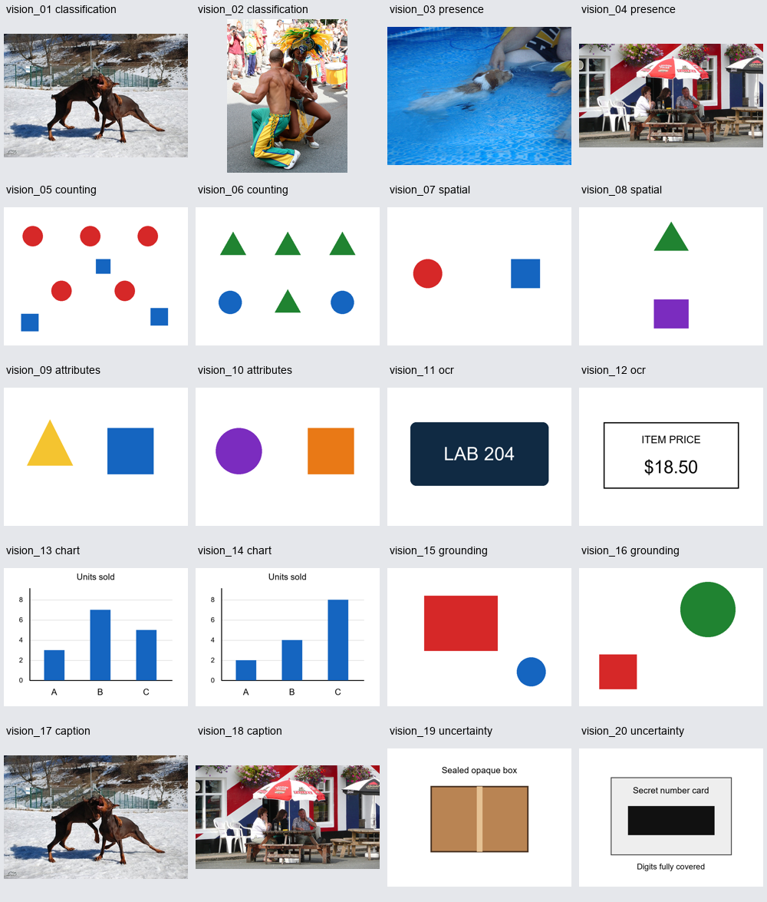
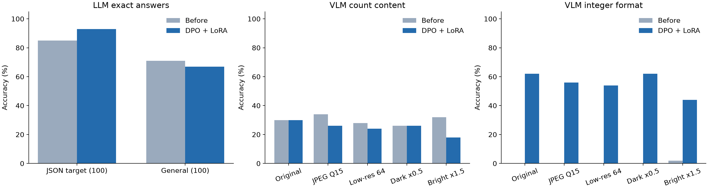

# Week 7 實驗成果

## Quiz 1：提示與量化

| 組合 | 客觀十題分數／100 | 商用二十題分數／100 | 整卡平均 GPU 記憶體 GiB |
|---|---:|---:|---:|
| BF16＋基本提示 | 59 | 76.75 | 18.956 |
| BF16＋優化提示 | 60 | 76.25 | 19.012 |
| NF4＋基本提示 | 59 | 75.75 | 10.807 |
| NF4＋優化提示 | 59 | 74.125 | 10.844 |

基本提示下 NF4 約省 43% 整卡記憶體，二十題生成時間 23.61 → 34.90 秒；提示優化沒有穩定提高分數。NVML 包含桌面等程序，PyTorch allocated 另存；平均採時間加權，原始樣本完整保留。

[完整 Quiz 1 報告](quiz1/Output/report.md) · [題目](quiz1/Data/benchmark_questions.md)

## Quiz 2：兩個 VLM

| 模型 | 十八題客觀正確率 | 二十題商用分數／100 |
|---|---:|---:|
| Qwen2.5-VL-7B | 83.33% | 87.50 |
| SmolVLM2-2.2B | 61.11% | 67.50 |

兩者各完成二十題，相同原始圖像與 user prompt。定位兩題都未達 IoU≥0.5 成功門檻；沒有刪除失敗。商用回覆由使用者手動上傳原圖取得並提供，評審名稱／日期為使用者記錄。

[完整 Quiz 2 報告](quiz2/Output/report.md)

## Quiz 3：實際偏好微調與影像條件

兩模型各 200 組 train、20 組 dev、三個 epoch／150 optimizer steps。LLM 另有一百目標題及一百無關通用題，VLM 另有五十圖 × 五條件，訓練／測試不重複。

| 指標 | 前 | 後 |
|---|---:|---:|
| LLM 目標 JSON 正確率 | 85% | 93% |
| 捏造缺失欄位次數 | 15 | 0 |
| LLM 通用題正確率 | 71% | 67% |
| VLM 原圖計數內容正確率 | 30% | 30% |
| VLM 五條件平均計數內容正確率 | 30% | 24.8% |

LLM 目標改善伴隨通用分數下降。VLM 格式遵從有所改進，但沒有證實計數內容提升，微調後 38 個回答達 token 上限；內容與格式分開呈現，不能把退化成無效回答當作成功降低幻覺。偏好 loss 下降不保證自由生成品質。

[完整 Quiz 3 報告](quiz3/Output/report.md)
