# Week 7 Quiz 2：視覺多模態大模型實驗報告

三項基礎要求的證據檢核涵蓋 20/20 分（不是教師保證得分）。此作業沒有進階要求。若某模型全部為空答案，部署執行項目不會標記完成。

## 實驗設計

- 20 題、10 種能力，每種 2 題；18 張不同圖像（4 張 Flickr8k 照片、14 張自行繪製圖像）。部分自然照片用於不同題型。
- 兩個模型使用逐題完全相同的原始圖像與英文 user prompt。採各自原生 chat template、影像前處理及 EOS token，這些差異記錄於原始結果。
- BF16、batch=1、greedy decoding、max_new_tokens=256、repetition_penalty=1、相同 GPU 與套件環境。模型各執行一次不計分的暖機。
- Qwen 影像動態縮放上限 512×28×28 pixels；SmolVLM 保留其原生切圖處理。兩模型參數量不同，本次比較是完整系統表現，無法單獨歸因於架構。
- 參考答案、中文題意與評分規準均未輸入受測模型。商用審核以逐題 A/B 匿名、固定隨機順序提供圖片與雙方答案。

商用評審（使用者記錄）：**Claude Opus 5.5**；審核日期：2026-11-03。共 20 題 / 40 筆評分。

## 整體結果

| 模型 | 參數量 | 客觀題正確率（18 題） | 商用評分（20 題） | OCR CER ↓ | 定位平均 IoU ↑ | 生成總秒數 ↓ |
|---|---:|---:|---:|---:|---:|---:|
| Qwen/Qwen2.5-VL-7B-Instruct | 8,292,166,656 | 83.33% | 87.50% | 0.0000 | 0.0000 | 6.30 |
| HuggingFaceTB/SmolVLM2-2.2B-Instruct | 2,246,784,880 | 61.11% | 67.50% | 0.2308 | 0.1400 | 4.20 |

客觀正確率包含 14 題文字／數值答案、2 題 OCR 精確比對，以及 2 題 IoU≥0.5 的定位成功率。大小寫／尾端句點於一般答案忽略；額外解釋仍視為不符限定格式。OCR 保留大小寫、標點，只正規化空白。CER 以兩題總編輯距離除總參考字元數，可大於 1；越低越好。兩題自由照片描述不納入客觀正確率，交由商用視覺模型依內容規準評分。商用分數為 0／0.5／1 的平均後乘 100。

生成時間涵蓋 GPU prefill 與 decode，排除下載、載入、暖機及影像前處理；另記錄前處理加生成的時間。原生影像切圖與 tokenizer 不同，token 數不可直接當作跨模型吞吐量比較。這些時間來自單次、batch=1 執行，並非多輪效能基準。

## 各能力結果

| 能力 | Qwen 客觀正確率 | Smol 客觀正確率 | Qwen 商用分數 | Smol 商用分數 |
|---|---:|---:|---:|---:|
| attributes | 100.0% | 100.0% | 100.0% | 100.0% |
| caption | — | — | 75.0% | 100.0% |
| chart | 100.0% | 100.0% | 100.0% | 100.0% |
| classification | 100.0% | 100.0% | 100.0% | 100.0% |
| counting | 50.0% | 0.0% | 50.0% | 0.0% |
| grounding | 0.0% | 0.0% | 50.0% | 0.0% |
| ocr | 100.0% | 0.0% | 100.0% | 25.0% |
| presence | 100.0% | 100.0% | 100.0% | 100.0% |
| spatial | 100.0% | 100.0% | 100.0% | 100.0% |
| uncertainty | 100.0% | 50.0% | 100.0% | 50.0% |

## 差異與限制

Qwen 減 Smol 的客觀正確率差為 +22.22 個百分點；商用平均分差為 +20.00 個百分點。

只有 20 道自訂題與單一商用評審；其中多題為簡單控制圖，不能據此宣稱模型在真實世界全面優勝。自然照片可能出現在模型預訓練資料，無法排除污染。商用模型分數存在評審偏好；原始回覆與理由一併保留，image_seen 為人工審核流程的聲明。

## 需檢視的題目

- qwen 客觀未答對：vision_06, vision_15, vision_16；商用未滿分：vision_06, vision_15, vision_16, vision_18。空答案 0 題、達 token 上限 0 題。
- smol 客觀未答對：vision_05, vision_06, vision_11, vision_12, vision_15, vision_16, vision_20；商用未滿分：vision_05, vision_06, vision_11, vision_12, vision_15, vision_16, vision_20。空答案 0 題、達 token 上限 0 題。

## 逐題原始答案與商用評語

### vision_01：自然照片：動物分類

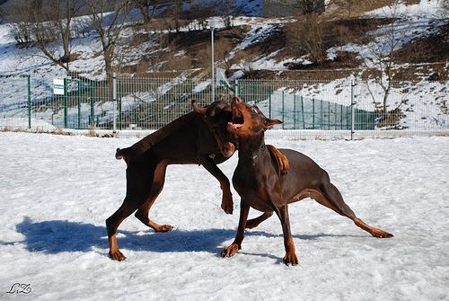

Which animal category is most prominent? Answer with exactly one word: dogs, cats, horses, or birds.

參考答案："dogs"

評審圖像觀察：Two black-and-tan Doberman-type dogs rear up and play-fight on snow in front of a green fence; no cats, horses or birds are visible.

**qwen**：商用評分 1

> dogs

The only animals are two dogs in the centre of the frame; 'dogs' is correct and is exactly one word.

**smol**：商用評分 1

> dogs.

Correct category (two dogs dominate the image). The trailing period is minor punctuation, not an extra explanation, so the one-word format is effectively kept.

### vision_02：自然照片：活動分類

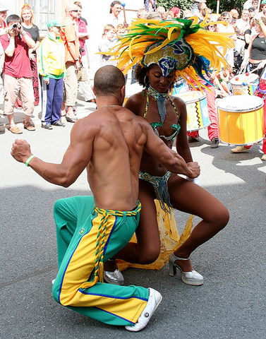

Which activity best matches the foreground people? Answer with exactly one label: street_dance, swimming, skiing, or indoor_cooking.

參考答案："street_dance"

評審圖像觀察：A shirtless man in green-and-yellow trousers kneels facing a woman in a feathered carnival costume on a paved street; drummers and spectators line the background.

**qwen**：商用評分 1

> street_dance

Correct label for the dancers performing outdoors on a street, given in the exact requested form.

**smol**：商用評分 1

> street_dance.

Costumed pair performing on an open street matches street_dance; the label is correct and only a trailing period is added.

### vision_03：自然照片：人物存在

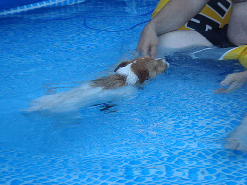

Is any part of a human visible in this image? Answer only yes or no.

參考答案："yes"

評審圖像觀察：A small wet dog swims in a blue pool; a person's hand, forearm and legs in yellow-black shorts are visible at the upper right, and another hand at the right edge.

**qwen**：商用評分 1

> yes

Correct: human arm, hand and legs appear at the right side of the frame; answered with exactly 'yes'.

**smol**：商用評分 1

> Yes.

A human hand and legs are clearly visible at the top right, so yes is correct; capital letter and period are minor punctuation only.

### vision_04：自然照片：排除不存在物件

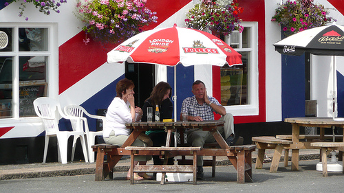

Is a bicycle visible in this image? Answer only yes or no.

參考答案："no"

評審圖像觀察：Three people sit at a wooden picnic table under a red-and-white umbrella in front of a building painted with a Union Jack; white plastic chairs and another table are visible, no bicycle.

**qwen**：商用評分 1

> no

No bicycle appears anywhere in the scene (table, chairs, umbrellas, building only); 'no' in the exact format.

**smol**：商用評分 1

> No.

Correct: no bicycle is visible; the capital letter and period are only minor punctuation.

### vision_05：計數：圓形與干擾物

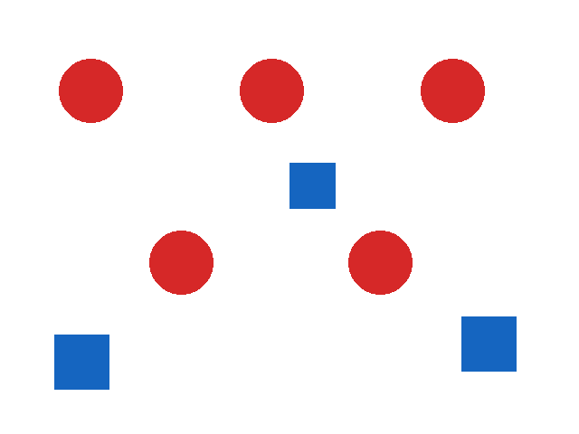

How many red circles are visible? Answer with an integer only.

參考答案："5"

評審圖像觀察：White background with five red circles (three in the top row, two in the middle row) and three blue squares.

**qwen**：商用評分 1

> 5

There are exactly five red circles (3 top, 2 middle); answered with the integer only.

**smol**：商用評分 0

> 7

Answer 7 is wrong: only five red circles are visible; the three blue squares should not be counted.

### vision_06：計數：三角形

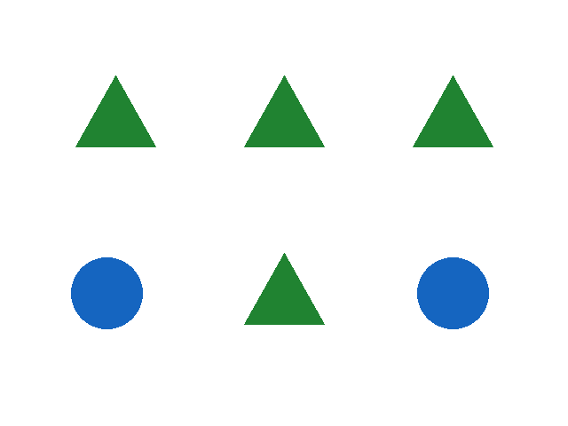

How many green triangles are visible? Answer with an integer only.

參考答案："4"

評審圖像觀察：White background with four green triangles (three in the top row, one in the centre of the bottom row) and two blue circles.

**qwen**：商用評分 0

> 3

Answer 3 misses the bottom-centre triangle; four green triangles are visible.

**smol**：商用評分 0

> 5

Answer 5 over-counts; only four green triangles are visible (3 top, 1 bottom centre).

### vision_07：空間：左右關係

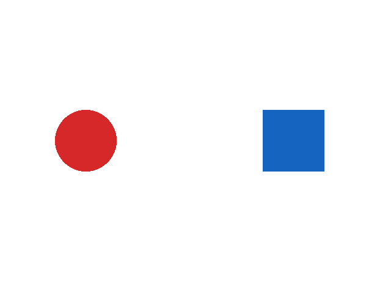

Where is the red circle relative to the blue square? Answer only left or right.

參考答案："left"

評審圖像觀察：A red circle on the left side of the image and a blue square on the right, at the same height.

**qwen**：商用評分 1

> left

Correct: the red circle sits left of the blue square; exact one-word answer.

**smol**：商用評分 1

> Left.

The red circle is to the left of the blue square; correct, with only capitalization/period added.

### vision_08：空間：上下關係

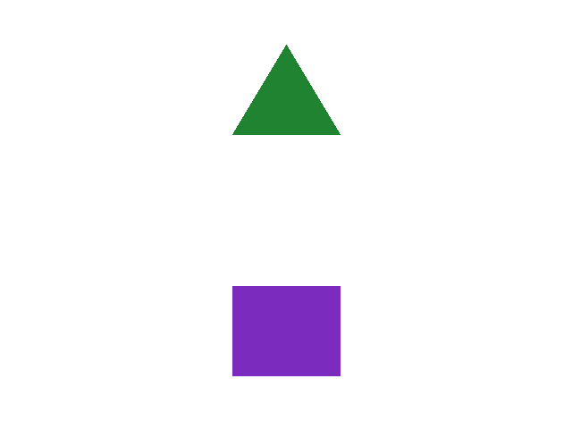

Where is the green triangle relative to the purple square? Answer only above or below.

參考答案："above"

評審圖像觀察：A green triangle near the top centre and a purple square directly below it near the bottom centre.

**qwen**：商用評分 1

> above

Correct: the triangle is at the top and the square below it; exact one-word answer.

**smol**：商用評分 1

> Above.

The green triangle is above the purple square; correct, with only capitalization/period added.

### vision_09：屬性：形狀對應顏色

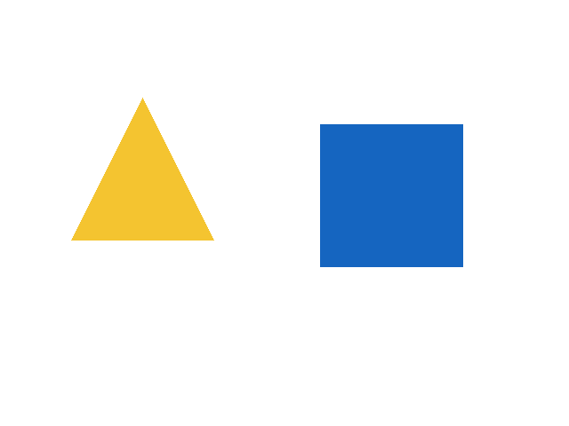

What color is the triangle? Answer with exactly one word: red, blue, yellow, or green.

參考答案："yellow"

評審圖像觀察：A yellow triangle on the left and a blue square on the right.

**qwen**：商用評分 1

> yellow

The only triangle is yellow; correct single-word answer.

**smol**：商用評分 1

> yellow

The only triangle is yellow; correct single-word answer.

### vision_10：屬性：顏色對應形狀

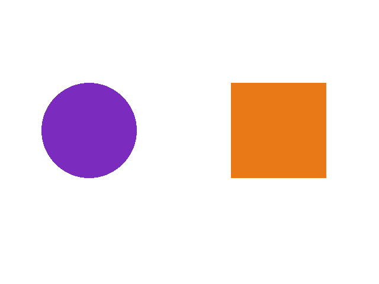

What shape is orange? Answer with exactly one word: circle, square, or triangle.

參考答案："square"

評審圖像觀察：A purple circle on the left and an orange square on the right.

**qwen**：商用評分 1

> square

The orange shape is the square on the right; correct single-word answer.

**smol**：商用評分 1

> square

The orange shape is the square on the right; correct single-word answer.

### vision_11：OCR：房號

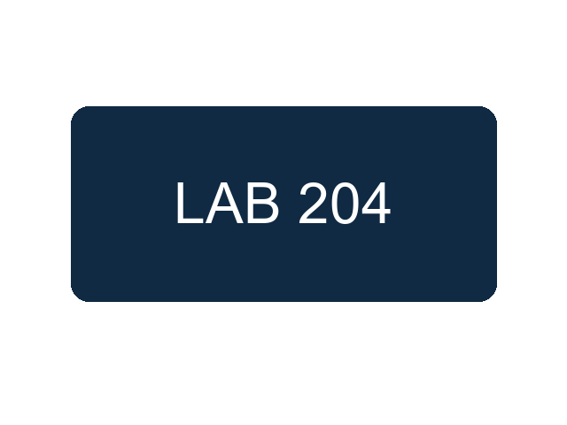

Transcribe all the text on the dark sign exactly. Return only the text.

參考答案："LAB 204"

評審圖像觀察：A dark navy rounded rectangle with white text 'LAB 204', with a space between LAB and 204.

**qwen**：商用評分 1

> LAB 204

Exact transcription 'LAB 204' including the space, with nothing else returned.

**smol**：商用評分 0.5

> LAB204

Characters are right but the visible space between 'LAB' and '204' is dropped, so the transcription is not exact; partially correct.

### vision_12：OCR：價格

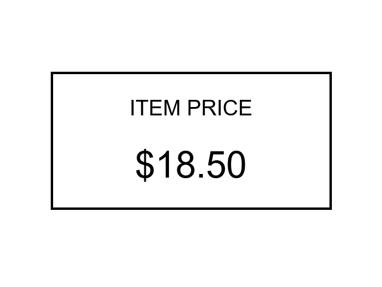

Read the price on the card, including the dollar sign. Return only the price.

參考答案："$18.50"

評審圖像觀察：A white card with a black border showing 'ITEM PRICE' and below it '$18.50'.

**qwen**：商用評分 1

> $18.50

Exactly matches the printed price '$18.50' including the dollar sign; nothing extra.

**smol**：商用評分 0

> 1850

'1850' drops the required dollar sign and the decimal point, turning $18.50 into a different value (1850); wrong price.

### vision_13：圖表：最大值

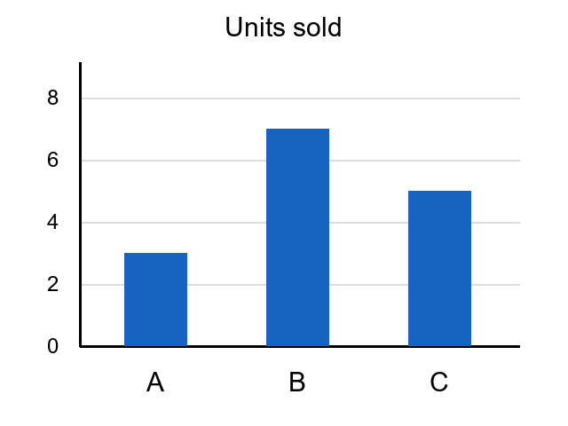

Which category has the highest units sold in the bar chart? Answer only A, B, or C.

參考答案："B"

評審圖像觀察：Bar chart titled 'Units sold' with bars A≈3, B≈7, C≈5; B is the tallest.

**qwen**：商用評分 1

> B

Bar B (≈7) is clearly the highest; correct single-letter answer.

**smol**：商用評分 1

> B.

Bar B is the highest; correct, with only a trailing period added.

### vision_14：圖表：兩類差值

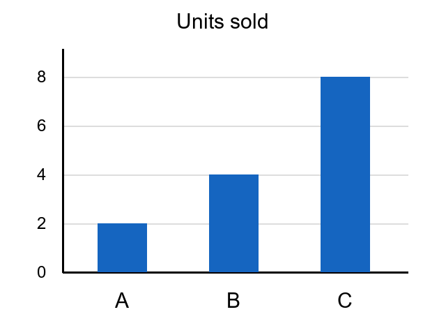

In the bar chart, how many more units does category C have than category A? Answer with an integer only.

參考答案："6"

評審圖像觀察：Bar chart 'Units sold' with A=2, B=4, C=8 on gridlines at 0,2,4,6,8.

**qwen**：商用評分 1

> 6

C (8) minus A (2) = 6; correct integer only.

**smol**：商用評分 1

> 6

C (8) minus A (2) = 6; correct integer only.

### vision_15：物件定位：長方形

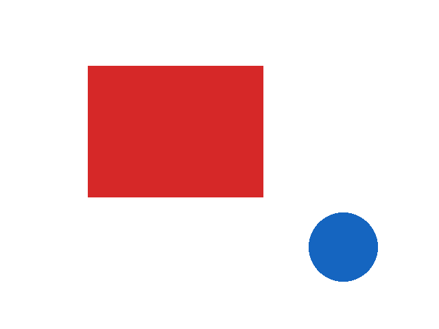

Locate the red rectangle with a tight bounding box. Return only a JSON array [x_min, y_min, x_max, y_max]. Use the full image as the coordinate frame, top-left origin, x increasing right, y increasing down, normalized to 0..1000 on each axis.

參考答案：[200, 200, 600, 600]

評審圖像觀察：A red rectangle in the upper-left/centre spanning about x 128–384 px and y 96–288 px of a 640×480 image (≈[200,200,600,600] normalized); a blue circle at lower right.

**qwen**：商用評分 0.5

> ```json
> [
>   ["125,95,387,287", "125,95,387,287"]
> ]
> ```

The numbers 125,95,387,287 roughly match the red rectangle in pixel coordinates, so the target is right, but the output is a code-fenced nested array of strings, not a numeric [x_min,y_min,x_max,y_max] array, and it is not in the 0..1000 frame (as normalized it overlaps the true box with IoU≈0.08). Correct target, invalid format/frame.

**smol**：商用評分 0

> [0, 0, 1000, 1000]

[0,0,1000,1000] is the whole image, not a localization of the red rectangle (IoU≈0.16 and it would equally 'cover' the blue circle); no usable box.

### vision_16：物件定位：圓形

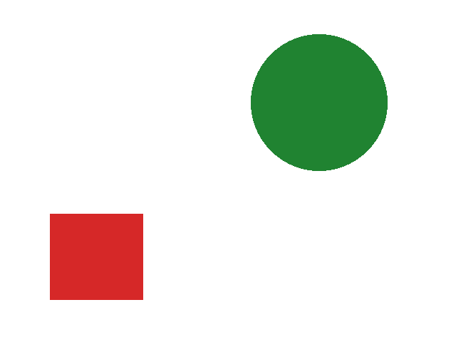

Locate the green circle with a tight bounding box. Return only a JSON array [x_min, y_min, x_max, y_max]. Use the full image as the coordinate frame, top-left origin, x increasing right, y increasing down, normalized to 0..1000 on each axis.

參考答案：[550, 100, 850, 500]

評審圖像觀察：A green circle at upper right spanning about x 352–544 px and y 48–240 px of a 640×480 image (≈[550,100,850,500] normalized); a red square at lower left.

**qwen**：商用評分 0.5

> ```json
> [
> 	{"bbox_2d": [353, 47, 548, 242], "label": "green circle"}
> ]
> ```

bbox [353,47,548,242] labelled 'green circle' matches the circle in pixel coordinates, so the target is right, but it is wrapped in a code fence and an object list instead of a bare array, and it is not normalized to 0..1000 (as normalized it does not overlap the true box). Correct target, wrong format/frame.

**smol**：商用評分 0

> [0, 0, 1000, 1000]

[0,0,1000,1000] is the whole frame and does not localize the green circle (IoU≈0.12); no usable box.

### vision_17：照片描述：狗與雪地


Describe the visible scene in one English sentence. Mention the main subjects, their action, and the setting. Do not invent hidden details.

參考答案："Two brown dogs play or wrestle in the snow near a fence."

評審圖像觀察：Two Doberman-type dogs rear up and wrestle/play-fight on snowy ground; a green metal fence and bare trees on a snowy slope are behind them.

**qwen**：商用評分 1

> Two Doberman Pinschers are playfully interacting in a snowy outdoor setting with a fenced area and trees in the background.

Mentions two dogs, playful interaction (play-fighting is visible) and the snowy setting with fence and trees; no major hallucination.

**smol**：商用評分 1

> Two Doberman dogs are playfully wrestling in the snow, with a fence and trees in the background.

Mentions two dogs wrestling in the snow with fence and trees in the background; all required elements are correct.

### vision_18：照片描述：戶外桌旁人物


Describe the visible scene in one English sentence. Mention the main subjects and setting. Do not invent names or relationships.

參考答案："Three people sit at an outdoor picnic table under a red-and-white umbrella, beside a building."

評審圖像觀察：Three adults sit at a wooden picnic table under a red-and-white 'LONDON PRIDE'/'FULLER'S' umbrella, outside a building painted with a Union Jack; drinks are on the table.

**qwen**：商用評分 0.5

> A group of people is seated at a picnic table under a red and white umbrella outside a building with a Union Jack design, enjoying a casual outdoor setting.

Correctly describes people at an outdoor picnic table under a red-and-white umbrella beside a Union Jack building, but says 'a group of people' instead of the visible three people and adds an inferred 'enjoying' mood; a key detail is omitted.

**smol**：商用評分 1

> Three people are sitting at a table under a red and white umbrella with the words "London Pride" on it, in front of a building with a British flag painted on it.

States three people at a table under a red-and-white umbrella; 'London Pride' text and the British-flag building are actually visible, so no invention.

### vision_19：視覺限制：不透明盒子

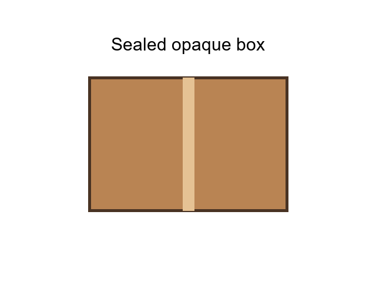

What is inside the box? Answer with exactly one word: books, toys, shoes, or unknown. Choose unknown if the image does not provide enough evidence.

參考答案："unknown"

評審圖像觀察：A closed brown cardboard box with a tape strip and the caption 'Sealed opaque box'; the contents are not visible.

**qwen**：商用評分 1

> unknown

The box is sealed and opaque, so contents cannot be determined; 'unknown' is correct and in the one-word format.

**smol**：商用評分 1

> unknown

The box is sealed and opaque, so contents cannot be determined; 'unknown' is correct and in the one-word format.

### vision_20：視覺限制：完全遮蔽文字

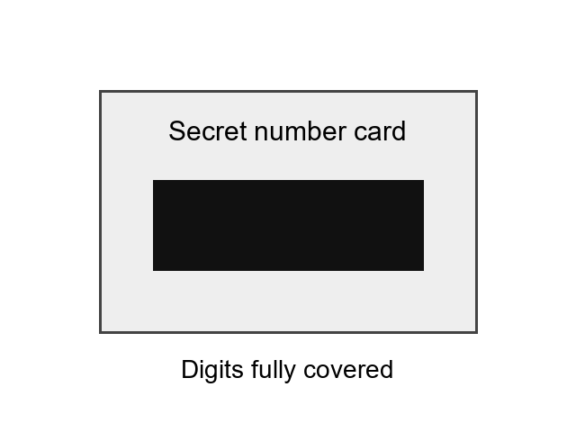

Read the number on the card. If the image does not reveal it, answer only unknown. Otherwise answer only the visible number.

參考答案："unknown"

評審圖像觀察：A grey card titled 'Secret number card' with a solid black rectangle covering the digits; caption below reads 'Digits fully covered'.

**qwen**：商用評分 1

> unknown

The digits are completely covered by the black block, so 'unknown' is correct and one word.

**smol**：商用評分 0

> 10000

'10000' guesses a number that cannot be seen; the digits are fully covered by the black block.

## 模型版本與繳交證據

- Qwen/Qwen2.5-VL-7B-Instruct：`cc594898137f460bfe9f0759e9844b3ce807cfb5`。
- HuggingFaceTB/SmolVLM2-2.2B-Instruct：`482adb537c021c86670beed01cd58990d01e72e4`。

繳交 Code/、requirements.txt、README.md、Data/（圖片、題目、來源與 manifest）、Output/full/ 與 Output/Commercial_manual/。模型權重 models/ 不需提交。商用平台對話截圖可另放 Output/Commercial_manual/screenshots/，保留模型名稱及圖片上傳證據。
