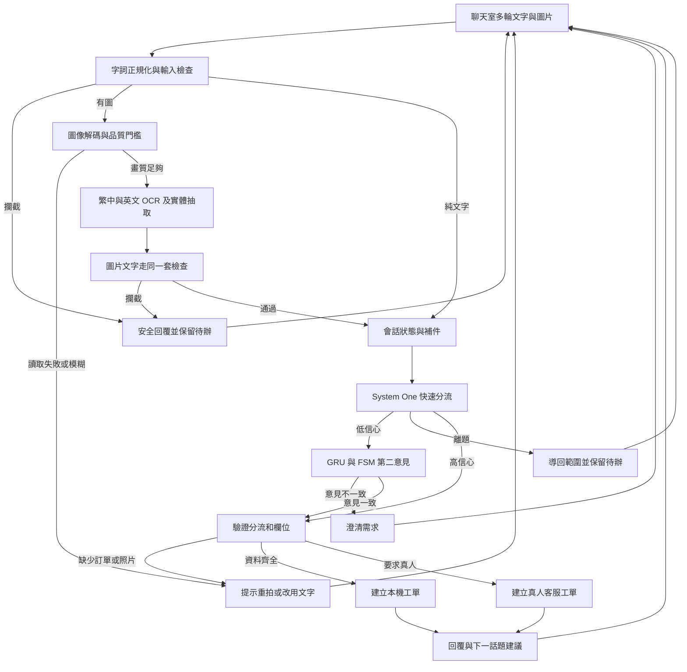

# 作業一 多模態多輪客服分流設計

EriXNet 是模擬的 3C 電子商城。客服機器人接收多輪文字及圖片，整理已知資料，必要時詢問缺少的資訊，再產生有指定部門的結構化工單。工單保存在示範程式的會話中，正式平台的部門佇列屬部署設計。

| 部門或處理出口 | 意圖 |
|---|---|
| 訂單與物流組 | `track_shipment`、`modify_order`、`cancel_order` |
| 退換貨組 | `request_return`、`report_defect`、`refund_status` |
| 技術支援組 | `troubleshoot_device`、`error_code` |
| 帳務與發票組 | `invoice_request`、`payment_issue` |
| 商品諮詢組 | `spec_question`、`stock_check` |
| 會員服務組 | `login_problem`、`update_profile` |
| 真人客服 | `complaint`、`request_human` |
| 導回商城服務 | `chitchat_offtopic` |
| 攔截不可信指令 | `prompt_injection` |

分流節點輸出一個 JSON 物件，欄位為 `route`、`intent`、`urgency`、`confidence`。程式同時檢查合法列舉、信心值範圍 `[0,1]` 和意圖與部門的對應。工單由政策層組裝，包括 `ticket_id`、部門、意圖、急迫度、已驗證的訂單編號、圖像發現、缺少欄位、下一個動作和對話摘要。需要訂單編號時會追問，瑕疵回報另外要求圖片。實作與評分使用同一份 [結構規格](../../quiz3/Code/triage/spec.py)。

- [分流 JSON Schema](../Data/triage.schema.json)
- [工單 JSON Schema](../Data/handoff.schema.json)
- [部門與意圖對照 JSON](../Data/route_intents.json)

課堂比較的四個節點採同一份分流規格。A 是 Qwen3 的純提示，B 是 Qwen3 LoRA SFT，C 在 B 的模型上加 token 約束，D 是 TF-IDF 分類器。線上示範用 D 搭配 CPU 的 GRU＋FSM 低信心路徑，避免每次開啟聊天室都要載入 GPU 模型。四法結果及整合結果分別見 [Quiz 2](../../quiz2/Output/report.md) 與 [Quiz 3](../../quiz3/Output/report.md)。

| 角落情境 | 系統處理 |
|---|---|
| 只上傳圖片 | 用 OCR 擷取錯誤碼或訂單號。待補訂單時可直接從截圖補齊。 |
| 無法解碼、超過大小限制、太模糊或過暗 | 上傳端拒絕無效檔案，品質檢查未通過則請使用者重拍或改用文字。 |
| 補件時遇到離題 | 單獨判斷該句，保留原待辦與缺少的欄位。持續離題時可選真人客服。 |
| 換下一筆訂單 | 預設先確認是否沿用。比較實驗也測試靜默沿用和可更正策略。 |
| 一句多個需求 | 對子句分流，僅採用高信心且彼此不同的業務意圖。 |
| 文字或圖像含不可信指令 | 檢查文字及 OCR，再決定是否允許進入工單流程。 |
| 路由不確定或回傳結構無效 | 問使用者澄清，政策層負責組裝工單。 |
| 無文字的照片 | 可作為補件附件，是否有裂痕等純視覺內容由收到工單的人員判讀。 |

原專案的詳細圖及 DOT 原始檔也保留，虛線表示部署規劃。[詳細架構圖](architecture.png) · [DOT 原始檔](../Code/architecture.dot)
