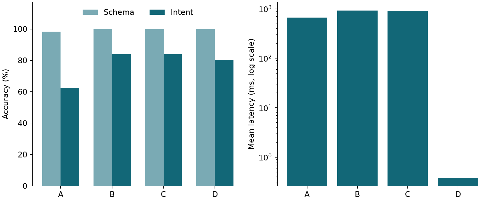

# 作業二 四種客服分流方法實測

四組都在同一份 56 筆基準上輸出 `route`、`intent`、`urgency`、`confidence`。題目包含 38 筆單輪、10 筆多輪及 8 筆圖像案例。圖片題使用原題庫已凍結的 OCR 文字。延遲比較由固定輸入開始計時，圖像上傳與 OCR 的額外耗時由整合端另行處理。

| 方法 | 實作 |
|---|---|
| A | Qwen3-1.7B，只有 system prompt 和三個示例，直接輸出回答。 |
| B | 同一版 Qwen3 加 LoRA SFT，解碼自由。只計算 assistant 完整 JSON 和結束 token 的損失。 |
| C | 同一個 B 的 adapter 和提示。每一步限制可生成 token，前綴樹包含 5,454 個合法 JSON 結果，包括 route/intent 的配對及信心值。 |
| D | System One。字元 1–3 gram TF-IDF，兩個 Logistic Regression 分類器分別預測意圖與急迫度，再按規格組出 JSON。 |

B 和 D 使用相同的 774 筆分層訓練資料，保留 90 筆驗證資料，核對無完全相同的基準輸入。B 在 NVIDIA GeForce RTX 5090 上訓練 2 個 epoch、98 次更新，耗時 100.0 秒。驗證損失依序為 0.00915, 0.00424。LoRA B 權重更新的 L2 差異為 2.374839，adapter 雜湊保存在訓練紀錄。

| 方法 | 結構合法 | 部門 | 意圖 | 急迫度 | 三欄皆對 | 平均 ms | P95 ms | 估算美元／千次 |
|---|---:|---:|---:|---:|---:|---:|---:|---:|
| A | 98.2% | 75.0% | 62.5% | 58.9% | 39.3% | 663.52 | 711.74 | 0.09216 |
| B | 100.0% | 89.3% | 83.9% | 89.3% | 78.6% | 918.91 | 1037.73 | 0.12763 |
| C | 100.0% | 89.3% | 83.9% | 89.3% | 78.6% | 910.07 | 993.05 | 0.12640 |
| D | 100.0% | 82.1% | 80.4% | 80.4% | 73.2% | 0.39 | 0.44 | 0.00000 |

結構合法指完整字串可解析為 JSON 並通過 schema 與部門、意圖配對檢查。無效結構的內容各欄一律計錯。A–C 使用 BF16、greedy、關閉 thinking、batch 1；D 使用 CPU。預熱、下載及訓練排除在延遲外。API 費用實際為 0，表中成本按實測延遲乘上假設費率 GPU $0.50／小時、CPU $0.04／小時估算，供同批比較。

| 方法 | 單輪意圖 | 多輪意圖 | 圖片意圖 |
|---|---:|---:|---:|
| A | 55.3% | 80.0% | 75.0% |
| B | 81.6% | 80.0% | 100.0% |
| C | 81.6% | 80.0% | 100.0% |
| D | 76.3% | 80.0% | 100.0% |

C 的約束確保這批資料的輸出符合結構，內容意圖仍需單獨評估。C 與 B 使用相同權重，比較的是解碼方式。資料與基準都來自原作業的合成客服情境。即使文字完全匹配已排除，主題與措辭仍可能相近，尤其是 OCR 片段。

[原始輸出](abcd_results.json) · [CSV 比較](comparison.csv) · [實際訓練紀錄](llm_training.json) · [基準題](../Data/benchmark.jsonl) · [模型來源](https://huggingface.co/Qwen/Qwen3-1.7B)
