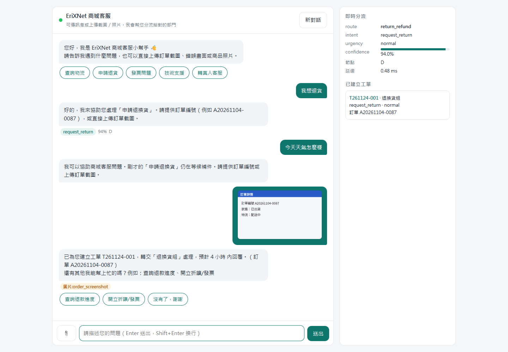

# 作業三 多輪客服整合與優化

聊天室接收文字及 PNG、JPEG、WebP 圖片。文字、OCR 和已知訂單資料共同支持分流，待補欄位會保留在會話中。右欄顯示路由、意圖、急迫度、信心、耗時與本機工單。已在瀏覽器操作退貨、途中離題與上傳訂單截圖，完成 `request_return` 工單並正確讀出 `A20261104-0087`。

手機響應式版面另有[實際截圖](chat_mobile.png)。整合版使用 System One 快路徑、GRU＋FSM 第二意見和不確定時的澄清。在 50 筆業務題、門檻 0.50 下，覆蓋率為 72.0%，已直接回答的案例意圖正確率為 94.4%。只使用 D 並一律回答的意圖正確率為 84.0%。覆蓋率與正確率需一起解讀。圖片以 OCR 和畫質檢查處理，無文字照片可作為附件交人工查看。工單為本機示範。

## UX 跨話題訂單確認

在 24 組模擬對話、67 個任務中比較四種策略。實際介面預設 `confirm`。完成當前請求後會顯示下一個常見需求的快捷按鈕。

| 策略 | 使用者訊息／任務 | 字數／任務 | 最終任務成功 | 初次錯單 | 最終錯單 |
|---|---:|---:|---:|---:|---:|
| none | 1.82 | 22.91 | 100.0% | 0 | 0 |
| silent | 1.36 | 13.66 | 82.1% | 12 | 12 |
| confirm | 1.82 | 18.37 | 100.0% | 0 | 0 |
| implicit | 1.51 | 16.79 | 100.0% | 10 | 0 |

相較每次重問，先確認使輸入字數少 19.8%，維持零錯單，訊息數相同。靜默沿用雖然字數最低，卻使 12 筆任務最後掛錯單。可更正策略假定模擬使用者會注意到錯單，因此初次錯單數仍須考慮。

## 聊到無關主題時保留服務進度

使用 30 筆離題與 50 筆業務題。按開發組選取 M3 的軟澄清門檻 0.45，再在保留一半的測試組回報。測試組離題誤接受從 100.0% 降至 6.7%，同時有 16.0% 業務題增加一次澄清，硬拒 0.0%。這是分類策略對照。獨立多輪重播使用聊天室預設門檻，從 7/8 改為 8/8 完成原任務。

補件中插入的離題句獨立判斷，保留現有待辦、所缺欄位與訂單確認。回覆會告訴使用者如何接回先前的業務，連續離題可以選真人客服。

## 文字與圖片輸入防禦

使用原有 32 筆合成風險案例（6 筆圖片）、62 筆正常案例重跑。先正規化、檢查文字及 OCR 內容，再進入會話狀態和工單政策。上傳端檢查檔案種類及大小。整合測試確認遭攔截的訊息保留原待辦，使用者能繼續完成退貨。

| 本機重測結果 | 既有基準 | 完整防禦 |
|---|---:|---:|
| 未被攔下或導回範圍的比例 | 12.5% | 0.0% |
| 正常案例誤擋率 | 3.2% | 3.2% |
| 易與風險句相似的正常案例誤擋率 | 16.7% | 16.7% |

不掃圖片時，防禦層本身的圖片攔截比例為 0.0%，掃描 OCR 後為 100.0%。下游分類器在此批圖片也提供保護，因此此比例和整套流程的未攔截比例應分開讀。上游附件把同一批題用於修訂，原始修訂前完整防禦仍有 3.1% 的案例未被攔截或導回。本次重測用同一組題庫證明既有情境下的改善，樣本範圍限於這組文字、OCR 圖像與模擬會話。

[完整重測資料](exp3_results.json) · [原附件修訂前結果](exp3_results_prefix.json) · [整合測試](verification_tests.txt)
